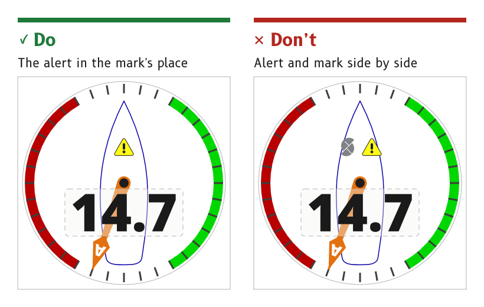

# Badges and markers

Badges and markers are the small flat symbols on a page. They are the SCADYS mark, the alert badge and the steer arrows. Each is exported as an alpha mask and tinted by its role, and each sits in a fixed place so the reader knows where to look for it.

*Figure 1: The mark and the alert share one spot.*

## Place the SCADYS mark above the pivot

On a dial page the SCADYS mark is 45 × 63 px, centred on (360, 238), in the `logo` role. It sits behind the needle, which sweeps over it when the wind is ahead.

- *Fade.* By day the mark fades toward the top, and at night toward the bottom, stopping at 35 % opacity.
- *Colour.* A neutral grey, `#808386` by day and `#4E5052` at night, the one neutral grey allowed at night.
- *Source.* `ux/specs/pages/wind.md`, logo mark. [Colour](../foundations/colour.md#keep-the-scadys-mark-neutral).

## Give the alert the mark's spot

The alert badge is 66 × 60 px, centred on the same point as the mark. An active alert replaces the mark rather than sitting beside it, and like the mark it sits behind the needle.

- *Source.* `ux/specs/pages/wind.md`, alert. The alert's states and behaviour are described under [Alerts](../patterns/alerts.md).

## Export a two-colour badge as two masks

A badge with two flat colours is exported as two alpha masks at the same position, each with its own role. The alert is `art_alert_fill` in `alert` and `art_alert_outline` in `alert_outline`.

- *Reason.* A single mask can carry only one tint, so each colour needs its own mask to recolour for night.
- *Source.* `ux/design/README.md`, drawing artwork. `ux/specs/pages/common.md`, "One artwork set for day and night".

## Show the steer arrows only when there is a correction to make

The port and starboard steer arrows sit in the top corners of a dial page, inside the safe area, in `port` and `starboard`. On a data page they sit inside the heading cell, one on each side of the value. An arrow shows only when the boat should bear away or come up to its target.

- *Source.* `ux/specs/pages/wind.md`, steer arrows. `ux/specs/pages/navigation.md`, top cell.

:::note[Not yet ruled]

- How the steer arrows are calculated from the bugs, and how the displays agree which bug is the target. The first build shows the arrows only in a test mode.
- Where the compass page's steer arrows move to, since they reach within about 15 px of the top corners.

These are tracked in `ux/specs/pages/wind.md` and `compass.md`.

:::
