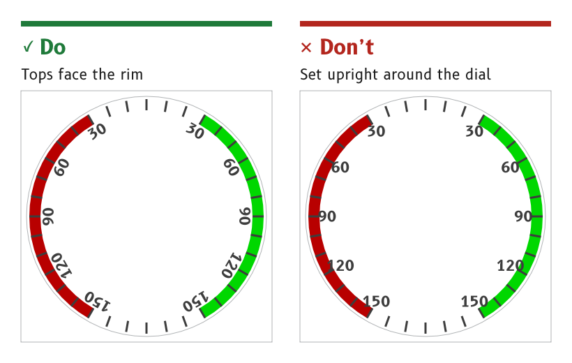

# Dials and rings

A dial page is built on one shared background: a round card recessed into a flat surround, with a ring of ticks around the card's edge. The wind page uses a fixed ring with port and starboard sectors, and the compass page uses a card that turns with the heading.

*Figure 1: Dial numbers are rotated so their tops face the rim.*

## Centre every dial on the canvas

A dial is centred exactly on (360, 360), and everything that turns on it pivots about that point.

- *Reason.* The firmware rotates needles, bugs and cards about the centre. A part that turns about any other point swings off the ring as it turns.
- *Source.* `ux/design/README.md`, "Draw from scratch on whole pixels".

## Recess the card into one shared surround

Every dial page uses the same background, `art_dial_surround`. It has a flat `surround` panel, an 8 px recess wall lit from above and a round card in the `card` role. It is shaded artwork, rendered in a day and a night version.

- *Day.* A light ivory surround around a white card.
- *Night.* A very dark warm brown surround around a black card, with the wall fading from black at the top to a dim amber at the bottom.
- *Reason.* One background drawn once serves the wind, compass and future tachometer pages, and the firmware holds one copy.
- *Source.* `ux/design/wind/BRIEF.md`, artwork to draw. UX concept register, SCY-SW-NOTE-UXCONCEPTS-001, "A recessed dial background". The wall itself is described under [Materials and depth](../foundations/materials-and-depth.md#use-the-one-recess-treatment).

## Draw the tick ring in code

The ring carries a major tick every 10° and a minor tick between each pair, drawn by the firmware in the `dial` role.

- *Major ticks* are 6 px wide, from radius 304 to 336.
- *Minor ticks* are 3 px wide, offset 5° from the major ticks, from radius 314 to 336.
- *Source.* `ux/specs/pages/wind.md`, dial ring.

## Rotate dial numbers to face the rim

Dial numbers sit on a circle inside the ring, each rotated so that its top faces the rim. They are set in B612 Bold in the `dial` role.

- *Wind page.* 30, 60, 90, 120 and 150 on each side, centred on a circle of radius 281.5, at 42 px. The tops of the digits clear the major tick ends by 4 to 5 px.
- *Compass card.* 3, 6, 12, 15, 21, 24, 30 and 33 every 30°, on a circle of radius about 290, turning with the card.
- *Placing a number.* Make it at 12 o'clock, group it with an invisible 720 px square and rotate the group about the centre. Measure after placing, because aligning to the glyph bounds shifts the digits outward.
- *Source.* `ux/specs/pages/wind.md`, dial numbers. `ux/specs/pages/compass.md`. `ux/design/LEARNINGS.md`, entry 34.

## Mark port and starboard with sector arcs

The wind dial carries a port sector from 30° to 150° on the left and a starboard sector from 30° to 150° on the right. Each arc is 32 px deep, from radius 304 to 336, the full length of a major tick, and the ticks are drawn over it.

- *Colours.* `port` and `starboard`. By day the starboard green is used only on wide arcs like these. At night both are dimmed to decoration.
- *Reason.* The sectors match the in-service MDD400, whose port and starboard colours were judged identical on the bench panel.
- *Source.* `ux/specs/pages/wind.md`, port and starboard sectors. `ux/design/LEARNINGS.md`, entry 30.

:::note[Not yet ruled]

- The colour of the compass cardinal letters N, E, S and W, now that red means port.
- Where the compass °M or °T unit and the steer arrows move to, since both reach into the MDD500 corner arcs.
- The tachometer page, a future dial page on the same background.

These are tracked in `ux/specs/pages/compass.md` and the UX concept register, SCY-SW-NOTE-UXCONCEPTS-001.

:::
