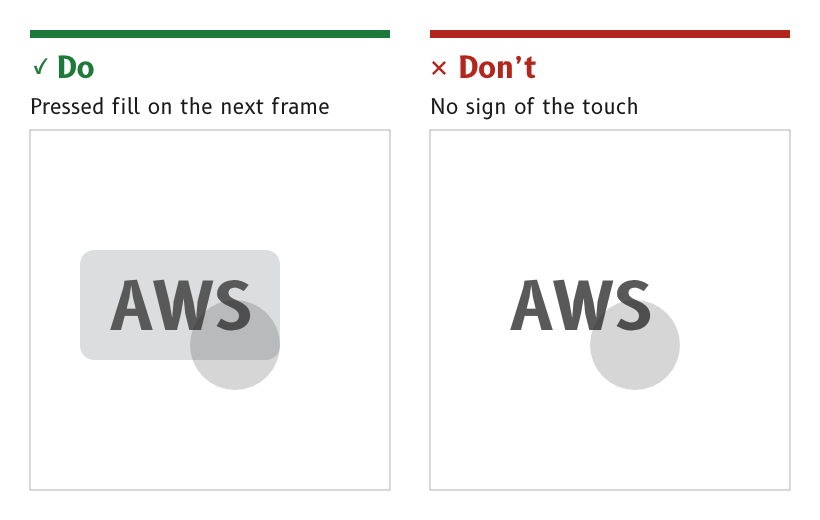

# Labels, units and buttons

On an MDD page the labels and units are the controls. A tap on a unit changes it and a tap on a label changes what it labels, so most settings are made where their effect is seen. Buttons are kept for actions and for dialogs.

*Figure 1: Every control shows a pressed state.*

## Make labels and units touch controls

Every label and unit on a page is a touch control. A label or unit with two states is a toggle label, which switches on a tap.

- *Examples.* °M and °T on the compass page, AWS and TWS and kt and BFT on the wind page.
- *Touch area.* The touch area covers the whole label region, not only the letters, as described under [Touch accessibility](../foundations/touch-accessibility.md#cover-the-whole-label-region).
- *Widget.* An LVGL `button` styled as text.
- *Source.* `ux/specs/pages/common.md`, touch. `ux/specs/interaction/controls.md`, toggle label.

## Set labels and units in their own roles

Labels are set in the `label` role and units in the `unit` role, both B612 Bold at 44 px.

- *Day colours.* Labels are `#595959` and units `#5E5E5E`, darkened from the in-service light grey `#B1B4B6`, which gave only 2.08:1 on white.
- *Night colour.* Both are a dim amber, `#A05A00`, well below the data.
- *Never in port red.* No label or unit is drawn in red, because red means port.
- *Source.* `ux/tokens/palette.json`, roles `label` and `unit`. `ux/specs/pages/navigation.md`, open items.

## Keep corner labels inboard

On a dial page the labels and units sit in the bottom corners, inside the MDD500 corner arcs. On the wind page AWS or TWS sits at (31, 641) to (134, 699) and kt or BFT at (615, 641) to (659, 699).

- *Source.* `ux/specs/pages/wind.md`, speed source label and speed unit. [Layout](../foundations/layout.md#keep-text-and-touch-targets-inside-the-corner-safe-area).

## Show a pressed state on every control

A control shows a `pressed` fill behind it on the next frame after it is touched, and acts when the finger lifts.

- *Colours.* `#DCDDDE` by day and `#381A00` at night.
- *Reason.* On a moving boat a touch is uncertain. A pressed state confirms that the display felt the finger before anything happens.
- *Source.* `ux/specs/interaction/touch.md`, feedback. `ux/tokens/palette.json`, role `pressed`.

## Use buttons for actions

A button carries an immediate action, such as Save or Cancel, with its text in the `label` role. An icon button carries an action shown by an icon, such as a menu icon, with the icon exported as an alpha mask and tinted by its role.

- *Flat.* Buttons are flat, because the page they sit on is flat.
- *Sized for the page.* There is no fixed button size, as described under [Layout](../foundations/layout.md#size-each-control-for-its-page).
- *Source.* `ux/specs/interaction/controls.md`, actions. `ux/design/LEARNINGS.md`, entry 29.

:::note[Not yet ruled]

- The visual design of each standard control in the palette, such as the switch, the slider, the picker and the dialog.
- How a tap on a data cell's value, which selects the series its graph plots, sits beside a tap on its unit.

These are tracked in `ux/specs/interaction/controls.md` and `touch.md`, open items.

:::
