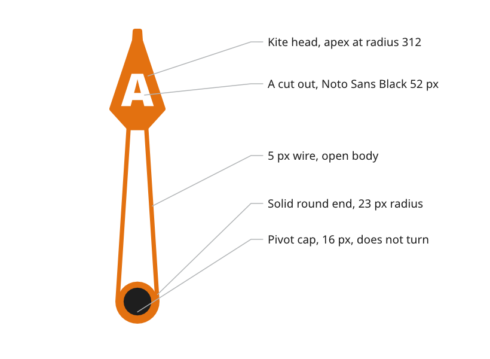

# Needles and pointers

Needles and pointers show an angle against a dial. Each one is drawn once, pointing straight up, and the firmware turns it about the dial centre. Each carries a letter so it is never identified by colour alone.

*Figure 1: The parts of the apparent wind needle.*

## Draw a turning part pointing up, in place

A part that turns is drawn pointing straight up, at 0°, in its true position on the page, with a small `#FF00FF` cross on the `REF pivots` layer at its rotation centre.

- *Reason.* The firmware turns the artwork about a known point. Drawn in place and pointing up, the asset needs no offset and no correction angle.
- *Source.* `ux/design/README.md`, drawing artwork and layers.

## Build the apparent wind needle as a wire needle

The apparent wind needle is a broad wedge from the pivot to radius 312, ending in a kite-shaped head, drawn in the `bug` role.

- *Wire body.* A 5 px wire follows the outline, and the body between the pivot and the head is open, so the card shows through it.
- *Pivot end.* A solid round end of 23 px radius, the same as the outside of the wire, fills the pivot end.
- *Head.* The kite head is laid over the wedge with the two apexes coincident over the tick at radius 312. The neck where the head meets the shaft is the wedge's width there, about 20 px.
- *Letter.* An A in Noto Sans Black at 52 px is cut out of the head, centred near radius 244, with a border of about 10 px at its sides and bottom corners.
- *Corners.* Every inside corner is rounded.
- *Source.* `ux/specs/pages/wind.md`, apparent wind needle.

## Light the needle as it turns

The firmware draws the needle's depth for each angle, because the needle turns and the light does not.

- *By day* a drop shadow is offset 2 px right and 6 px down, at 35 % black.
- *At night* a glow in the needle's own colour replaces the shadow, starting after a 2 px dark gap and kept out of the cut-out letter.
- *Ridge.* Each half of the needle is brightened or darkened by up to 20 % by how far it faces a light just left of straight up. The ridge shading stops at the pivot centre, so the round end is flat.
- *Source.* `ux/specs/pages/wind.md`, apparent wind needle. [Materials and depth](../foundations/materials-and-depth.md#raise-an-element-with-a-shadow-by-day-and-a-glow-at-night).

## Cap the pivot

A disc of 16 px radius in the `hub` role covers the pivot. It does not turn and is drawn over the needle by the firmware, lit as a dome from 50° above the screen.

- *Colours.* Almost black by day, `#1E1E1E`, and a very dark warm brown at night, `#140A00`.
- *Reason.* A cap in the needle's own colour was too bright at night.
- *Source.* `ux/specs/pages/wind.md`, pivot cap. `ux/tokens/palette.json`, role `hub`.

## Mark true wind with a short pointer

The true wind pointer is a short pointer on the ring at the true wind angle, carrying the letter T.

- *Source.* `ux/specs/pages/wind.md`, true wind pointer.

## Show a target with a bug

A bug marks a target on the dial, in the `bug` role. The wind bug is the target wind angle and the heading bug on the compass page is the target heading. Each is set by hand or provided by the autopilot, and with the steer arrows it shows which way to steer.

- *One target at a time.* Only one bug, heading or wind, can be the steering target, so the displays must coordinate when the compass and wind pages sit on separate instruments.
- *Source.* `ux/specs/pages/wind.md`, wind bug and data. `ux/specs/pages/compass.md`, data.

:::note[Not yet ruled]

- The colour of the true wind pointer, by day and at night, because the night palette allows no neutral grey.
- The night colour of the `needle` role, a blue in the draft.
- How a bug is set, how the steer arrows are calculated and how the displays agree which bug is the target. The first build places the bug at a fixed test angle.

These are tracked in `ux/specs/pages/wind.md`, `ux/tokens/palette.json` and the UX concept register, SCY-SW-NOTE-UXCONCEPTS-001.

:::
