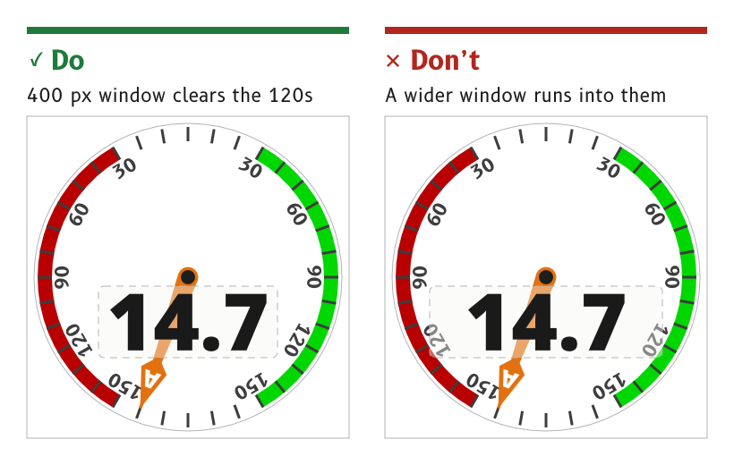

# Readouts and windows

A readout is the number a page exists to show. On a dial page it floats in a frameless window in front of the needle, and on a data page it sits centred in its cell.

*Figure 1: A readout window stays clear of the dial numbers.*

## Float a dial readout in a frameless window

On a dial page the readout sits in a frameless window in front of the needle. The window is its floor alone, a rounded rectangle in the `surround` role at 40 % opacity, and the digits sit on top at full strength.

- *Wind page.* The window spans (160, 380) to (560, 540) with 12 px corners. 400 px is the widest window that clears the 120 dial numbers on each side.
- *No wall.* With the needle passing behind it the window floats, so it carries no recess wall.
- *Reason.* The needle shows through the window softened, so its angle can still be read while the digits stay clear. The floor was lowered from 60 % to 40 % so the needle shows more clearly behind the digits.
- *Source.* `ux/specs/pages/wind.md`, wind speed window. `ux/design/LEARNINGS.md`, entry 41.

## Set a dial readout in `value-l`, centred on its ink

The wind speed is set in Noto Sans Black at 177 px, the `value-l` role, in the `data` colour, with its ink centred on (360, 460).

- *Ink, not em box.* A type object's bounds are its em box, so the digits are centred by measuring an outlined copy and moving the text by the difference.
- *Fixed decimal point.* The decimal point stays still and the tens digit appears and disappears, as described under [Motion](../foundations/motion.md#keep-the-decimal-point-still).
- *Source.* `ux/specs/pages/wind.md`, wind speed. VectorCraft runbook, how the canvas behaves.

## Centre a cell value below its label line

In a data cell the value is centred in the cell, below the line that carries the label at the top left and the unit at the top right. This holds in every cell, from the large heading cell to the smallest.

- *Roles.* `value-xl` in the primary cell and `value-m` in the secondary cells, as listed under [Typography](../foundations/typography.md#use-a-type-role-never-a-free-size).
- *Source.* `ux/specs/pages/navigation.md`, inside a cell. `ux/specs/layouts/README.md`, shared rules.

## Put the cross-track value inside the vessel marker

On the navigation page's cross-track bar the value, such as 1.2, sits inside the vessel marker at the centre of the bar, with its unit at the right of the cell. The bar's ticks run left in `port` and right in `starboard_mark`, growing taller away from the centre, and the cross-track bug moves along it.

- *Source.* `ux/specs/pages/navigation.md`, XTE bar.

:::note[Not yet ruled]

- How a graph strip shows which cell it is plotting, on pages that use a time-series graph in place of the cross-track bar.
- The typeface of the cell values, until `value-xl` and `value-m` are judged against Noto Sans Black on the panel.

These are tracked in `ux/specs/layouts/primary-4-graphic.md` and SCY-SW-ISSUE-UXPANELTEST-001.

:::
