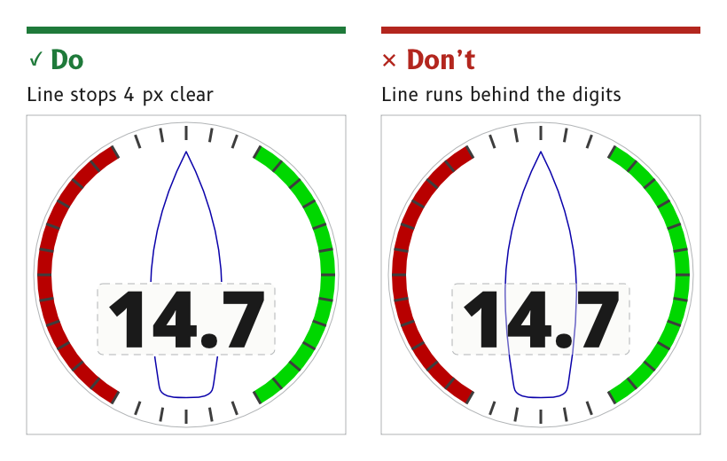

# Vessel outline

The vessel outline puts the boat at the centre of a dial, so every angle on the dial reads relative to the bow. It is a thin line in the `vessel` role, drawn behind everything that carries data.

*Figure 1: The outline stops short of the readout window.*

## Draw a sailboat's hull

The hull is a sailboat's, not a powerboat's. Its sides curve back in toward a narrow stern of about 60 % of the beam and turn smoothly into a transom that bows aft, with no sharp corners.

- *Wind page.* About 163 × 556 px, centred on x = 360, from the bow at y = 82 to the transom at y = 638.
- *Reason.* The MDD displays are made for leisure vessels, primarily sailboats.
- *Source.* `ux/specs/pages/wind.md`, vessel outline. `ux/design/_template/SVG/Day_Vessel.svg`. MDD400 product identity, SCY-PROD-NOTE-MDD400-001.

## Keep the line at 3 px with round ends

The outline is a 3 px line with round ends and round joins, and no heavier.

- *Source.* `ux/specs/pages/wind.md`, vessel outline.

## Break the outline at the readout

Where the hull passes the readout window, the line stops 4 px clear above and below the window rather than running behind it.

- *Source.* `ux/specs/pages/wind.md`, vessel outline.

## Keep the outline behind the data

The outline sits behind the window, the needle and the SCADYS mark. The space it leaves between bow and pivot sets where the mark and the alert can go.

- *Source.* `ux/specs/pages/wind.md`, vessel outline.

## Use the vessel marker on the cross-track bar

On the navigation page the vessel appears as a marker at the centre of the cross-track bar, in the `vessel` role, with the cross-track value inside it.

- *Source.* `ux/specs/pages/navigation.md`, XTE bar.

:::note[Not yet ruled]

The night colour of the `vessel` role, a blue in the draft, which the night-vision review ranks high for rod stimulus. An amber or dim red outline is the alternative. Tracked in `ux/tokens/palette.json`, open items.

:::
