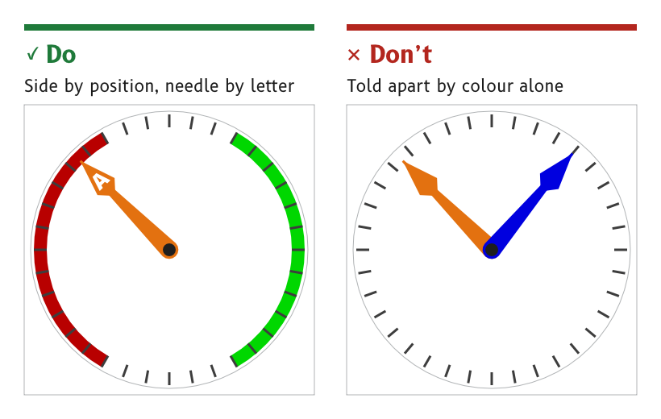

# Legibility

An MDD display is an instrument, not a chart plotter. It shows the same page for days, usually with nobody touching it, and it is read in a glance from a helm or a bunk. Every other rule in these guidelines serves that glance.

*Figure 1: Colour is never the only cue.*

## Design for a glance at 1 to 2 m

A page is designed to be read at 1 to 2 m, in direct sun and at night, by someone who looks at it for a moment and looks away.

- *Reason.* Nobody studies an instrument at sea. A value that needs a second look has failed, and a second look at night costs dark adaptation.
- *Check.* A page is judged on the real panel at 1 to 2 m, by day and at night. A desktop monitor is not a substitute, because it cannot show the night colours at the panel's brightness.
- *Source.* `ux/design/README.md`, "Look first, rules second". Font selection, SCY-SW-NOTE-FONTS-001.

## Make the data the brightest element

The data value is the brightest element on a page that is not an alert, by day and at night.

- *Reason.* The eye goes to the brightest thing first. A label, a frame or a decoration that outshines the value it belongs to pulls the glance away from the one thing it came for.
- *Exception.* An alert may outshine the data, because an alert is rare and has to be seen.
- *Check.* `tokens/render_swatches.py` fails the palette if any night colour other than an alert is brighter than the data colour.
- *Source.* `ux/tokens/palette.json`, rules. Palette rulings, SCY-SW-DECISION-PALETTE-001.

## Never use colour as the only cue

Every meaning carried by colour is carried by something else as well.

- *Port and starboard* are coded by position, port on the left and starboard on the right, as well as by red and green.
- *Needles and pointers* are coded by a letter, such as A for apparent wind and T for true wind, as well as by colour.
- *Alerts* are coded by the triangle shape, as well as by yellow.
- *Reason.* Colour vision varies between people, the night palette dims port and starboard almost to decoration and sunlight washes colour out. A cue that survives without its colour survives all three.
- *Source.* `ux/tokens/palette.json`, rules.

## Let legibility win over effects

Where a realistic effect costs readability, readability wins. Depth, lighting and shading stay where they help the eye and give way where they compete with the data.

- *Example.* On the wind page the apparent wind needle passes behind the wind-speed readout instead of across its digits, as described under [Materials and depth](./materials-and-depth.md#keep-readouts-in-front-of-needles).
- *Reason.* An instrument that looks like an analogue gauge but reads worse than a plain number has failed at its job.
- *Source.* UX concept register, SCY-SW-NOTE-UXCONCEPTS-001, "Legibility wins over skeuomorphism".

## Use a white background by day

The day background is white, `#FFFFFF`.

- *Reason.* The display standard for electronic charts, IHO S-52, records in s4.2.5 that a maximum-luminance background gave the best contrast under near-washout in an outdoor sun test.
- *Source.* `ux/tokens/palette.json`, role `background`. Palette derivation, SCY-SW-NOTE-PALETTE-001, citing IHO S-52 Edition 6.1.1.

## Judge by eye, then write the rule

Proportions, white space and balance are judged by eye on a complete mockup and on the panel. Spacing and size rules are written afterwards, from pages that already look right.

- *Reason.* Rules written before a page exists tend to produce a page that obeys them and still looks wrong.
- *Source.* `ux/design/README.md`, "Look first, rules second".

:::note[Not yet ruled]

The draft palette and the font roles are still to be judged on the MDD500 panel at 1 to 2 m, in direct sun and in the dark. The test is tracked as SCY-SW-ISSUE-UXPANELTEST-001.

:::
