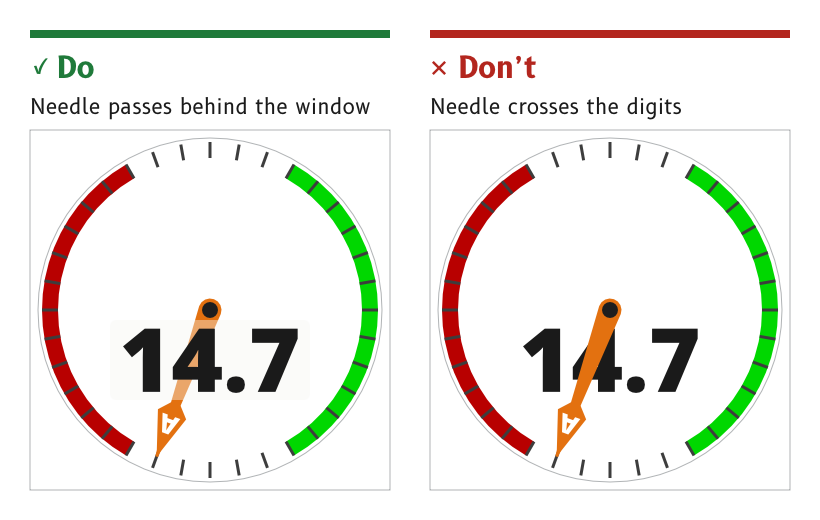

# Materials and depth

The MIPI panels show 24-bit colour with transparency and smooth edges, so an MDD page can look built rather than printed. A dial sits recessed in its panel, a needle floats over the card and a readout window floats over the needle. Depth is used where it helps the eye find the data, and it gives way wherever it competes with the data.

*Figure 1: Readouts stay in front of needles.*

## Keep large surfaces flat

A large surface, such as the panel around a dial, is one flat colour. Gradients are kept for small depth cues, such as the wall of a recess.

- *Reason.* A gradient across a 720 px surface banded visibly on the panel and added little, because the recessed ring already gave the depth. A flat page also lets every button on it be flat.
- *Source.* `ux/design/LEARNINGS.md`, entry 29. UX concept register, SCY-SW-NOTE-UXCONCEPTS-001, "Flat surfaces, gradients for small depth cues".

## Light every page from above

Every depth cue on a page is lit from one direction, from above. A recess wall is dark at the top and catches the light at the bottom, by day and at night. The ridge of a needle is lit from just left of straight up, and a pivot cap is lit as a dome from 50° above the screen.

- *Reason.* Depth reads only when the light is consistent. A shadow on one element that disagrees with the light on another flattens both.
- *Source.* `ux/design/LEARNINGS.md`, entries 18 and 35. `ux/specs/pages/wind.md`, apparent wind needle and pivot cap.

## Use the one recess treatment

Every recessed element uses the same wall. The wall carries a gradient lit from above, from `wall_shade` at the top to `surround_light` at the bottom. A stroke over it carries a second gradient across the wall's width, from `wall_shade` at 80 % opacity where the wall meets the floor to clear at the lip.

- *Sizes.* The dial wall is 8 px. A window wall is 6 px.
- *Reason.* One treatment, chosen on the panel from four, keeps every recess on every page reading as the same material.
- *Source.* `ux/design/LEARNINGS.md`, entry 38. UX concept register, SCY-SW-NOTE-UXCONCEPTS-001, "One recess treatment".

## Raise an element with a shadow by day and a glow at night

An element that floats over the page, such as a needle, casts a drop shadow by day. At night a shadow cannot darken a black card, so the element carries a glow in its own colour instead, separated from it by a dark gap.

- *Day shadow.* A blurred copy of the element, offset 2 px right and 6 px down, at 35 % black.
- *Night glow.* The element's outline grown by 3 px and blurred by 8 px, in its own colour at 50 %, starting 2 px clear of the element. The glow is kept out of anything cut out of the element, such as a letter, so the cut-out stays black.
- *Turning elements.* The firmware draws the shadow and the glow for each angle, because a needle turns and the light does not. Artwork for the panel carries no shadow of its own.
- *Reason.* Depth that vanishes at night would make the night page read differently from the day page. On the panel a glow with no spread was invisible, and a glow grown by 4 to 8 px swamped the needle and lost its edge.
- *Source.* `ux/specs/pages/wind.md`, apparent wind needle. `ux/design/LEARNINGS.md`, entry 43.

## Keep readouts in front of needles

A needle passes behind a digital readout rather than across its digits. The readout is a frameless window whose floor is the `surround` colour at 40 % opacity, so the needle shows through it softened, and the digits sit on top at full strength.

- *Reason.* A needle crossing the digits makes the number hard to read at the moment it matters. Darkening the needle over the digits, and making it translucent over the whole window, were both tried on the panel and rejected.
- *Source.* `ux/specs/pages/wind.md`, wind speed window. UX concept register, SCY-SW-NOTE-UXCONCEPTS-001, "Needles behind readouts".

## Cut letters out of needles

A letter that identifies a needle or pointer, such as the A on the apparent wind needle, is cut out of it, so the card shows through: white by day and black at night.

- *Reason.* A cut-out letter takes its colour from the card, so it stays legible on the needle in both modes without a colour of its own.
- *Source.* `ux/specs/pages/wind.md`, apparent wind needle.

## Draw artwork once for day and night

A page is drawn once, in day colours, and the firmware recolours it for night.

- *Flat artwork* is exported as an alpha mask and tinted by its role.
- *Shaded artwork*, with gradients or highlights, is a full-colour image drawn with role swatches as its gradient stops and rendered in a day and a night version.
- *Structural differences*, such as the light panel behind the wind speed being absent at night, are style switches in firmware rather than separate night artwork.
- *Reason.* Two artwork sets drift apart. One set, recoloured by role, cannot.
- *Source.* `ux/specs/pages/common.md`, "One artwork set for day and night".

:::note[Not yet ruled]

- The backlit look of a luxury car's instrument cluster, with cards lit from behind and needles and bugs lit from inside. A dedicated session on depth and lighting is owed.
- Frosted-glass dialogs, which the MDD400 could not show and the MIPI panels can.

These are tracked in the UX concept register, SCY-SW-NOTE-UXCONCEPTS-001.

:::
