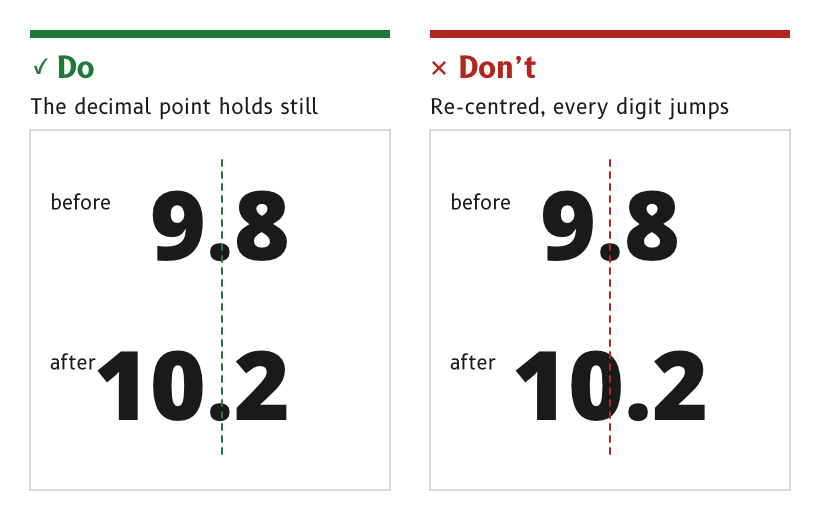

# Motion

Movement on an MDD page carries meaning. A needle moves because the wind moved, and an alert throbs because something needs attention. Anything else that moves is noise, so a page keeps still everything that has no reason to move.

*Figure 1: The decimal point holds still while the value changes.*

## Keep the decimal point still

A value with a decimal point keeps the point in a fixed position. When the value gains or loses a digit, such as 9.8 becoming 10.2, the tens digit appears or disappears and no other digit moves.

- *Reason.* A re-centred number shifts every digit sideways at each change of length, which the eye reads as movement in the data. A fixed point lets the eye stay on the digit it is reading.
- *Depends on* digits of equal width, as described under [Typography](./typography.md#use-digits-of-equal-width).
- *Source.* `ux/specs/pages/wind.md`, wind speed.

## Throb an active alert, and hold a snoozed one still

An active alert throbs about once a second at full opacity, blending between `alert_throb_low` and `alert_throb_high`. A snoozed alert holds still.

- *By day* the throb stays yellow, from a slightly darker to a slightly brighter yellow around the alert yellow.
- *At night* it runs from the night alert yellow to a yellow 40 % darker, so it never brightens beyond the night alert colour.
- *Reason.* The one thing on the page that must be noticed is the one thing that pulses. A snoozed alert has been seen, so it stops asking for attention but stays in view.
- *Source.* `ux/specs/pages/wind.md`, alert. Palette rulings, SCY-SW-DECISION-PALETTE-001, consequences.

## Smooth needles on the page

A needle follows its data, smoothed by the page that draws it. The page reads the last good value at its own frame rate and smooths the angle, rather than taking each reading as it arrives.

- *Reason.* A needle's movement is read as the wind's movement. An unsmoothed needle shakes with every reading, and the shake reads as gusts that are not there.
- *Source.* `ux/design/wind/BRIEF.md`, data each element shows.

## Show a touch on the next frame

A control shows its pressed state on the next frame after it is touched, and the action it starts completes within 100 ms. An action that takes longer than 250 ms shows that it is working. A long press shows its progress, so the user knows to keep holding.

- *Reason.* 100 ms is the response a person perceives as immediate, by Google's [RAIL model](https://web.dev/articles/rail), and 250 ms is the longest response [NHTSA's driver distraction guidelines](https://www.govinfo.gov/content/pkg/FR-2013-04-26/pdf/2013-09883.pdf) allow before the user needs reassurance.
- *Source.* `ux/specs/interaction/touch.md`, feedback. `ux/specs/interaction/controls.md`, presentation.

## Never time out in the middle of an action

Nothing on a page times out while the user is part-way through an action. The user sets the pace and can stop at any moment.

- *Reason.* On a moving boat a task is interrupted constantly, by a wave, a sheet or a crew member. A task that resets while the user looks away has to be started again.
- *Source.* `ux/specs/interaction/touch.md`, principles.

:::note[Not yet ruled]

- The smoothing time of each needle and the time after which a value counts as stale. Both are set in firmware and tuned on the display.
- Whether a needle's movement is limited to a maximum rate, and the frame rate a page is drawn at.
- How a stale value is shown, tracked in `ux/specs/pages/common.md`, data states.

:::

## References

1. Google, [*Measure performance with the RAIL model*](https://web.dev/articles/rail), web.dev.
2. National Highway Traffic Safety Administration, [*Visual-Manual NHTSA Driver Distraction Guidelines for In-Vehicle Electronic Devices*](https://www.govinfo.gov/content/pkg/FR-2013-04-26/pdf/2013-09883.pdf), Federal Register vol. 78 no. 81, 2013.
