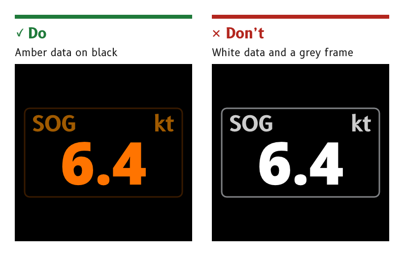

# Night

At night the display must be readable without spoiling the dark adaptation of the person reading it, or of anyone else on deck. The night palette is amber data on black, the brightness comes from the backlight rather than from the colours, and nothing on a night page is white.

*Figure 1: The night page uses no white and no neutral grey.*

## Show night data in amber

Night data is amber, `#FF7400`. Labels, units and dial graduations are dimmer ambers, and every one of them stays below the data in brightness.

- *Reason.* Amber keeps the data legible at low brightness. A red night palette reads poorly in service on other marine displays, and red data would clash with red as the port colour.
- *Source.* Palette rulings, SCY-SW-DECISION-PALETTE-001, ruling 1. `ux/tokens/palette.json`.

## Use no white and no neutral grey at night

A night page has no white, no neutral grey and no full-white frame. The one exception is the SCADYS mark, described under [Colour](./colour.md#keep-the-scadys-mark-neutral).

- *Reason.* Night vision depends on the rods of the eye, and white and neutral grey stimulate them most. Weighted for rod sensitivity at the backlight floor, the white compass element of the in-service MDD400 gave 5.0 scotopic cd/m² and its `#CCCCCC` splash logo 3.0, the worst and third-worst of every colour on the in-service pages.
- *Source.* `ux/tokens/palette.json`, rules. Palette derivation, SCY-SW-NOTE-PALETTE-001, night-vision protection critic.

## Make the night background black everywhere

The night background is `#000000` on every surface, including dialogs, panels and containers.

- *Reason.* Contrast at night is already scarce. The in-service night background `#292728` cost about 25 times the contrast of black behind the numerals at the backlight floor.
- *Source.* `ux/tokens/palette.json`, rules. Palette derivation, SCY-SW-NOTE-PALETTE-001, night legibility critic.

## Start dark and fade in

Every start begins with the backlight at zero. The display reads its light sensor, sets day or night from it and fades the backlight in to the brightness the sensor calls for. Neither the mode nor the brightness is restored from storage. The splash page shows during the fade-in by day and by night, so the display never flashes bright.

- *Reason.* Full brightness at start-up dazzles a dark-adapted eye at the one moment nobody expects it. A brightness restored from the last use can bring the display up at full brightness at night, a fault Gerhard has met on other marine displays, while the MDD400 always started dark and faded in.
- *Source.* SCY-SW-DECISION-DARKSTART-002. `ux/specs/pages/splash.md`, night, ruled by Gerhard on 12 October 2026. `ux/tokens/palette.json`, rules.

## Dim with the backlight, not with the colours

The backlight sets night brightness, down to its floor of 2.3 cd/m² for white at the panel surface. The night colours fix the brightness of each role relative to the others, and the backlight scales them all.

- *Reason.* An LCD's black is backlight leaking through closed pixels. Lowering the pixel values dims the data but leaves the black where it was, so it costs contrast one for one. Lowering the backlight dims both together.
- *Last resort.* Scaling the night colours below the backlight floor is kept only for the case where the measured floor proves too bright.
- *Source.* Palette rulings, SCY-SW-DECISION-PALETTE-001, ruling 4. `ux/tokens/README.md`, night brightness.

## Keep port and starboard, dimmed

Port red and starboard green stay on the night page, dimmed, as decoration.

- *Reason.* Position already tells the two sides apart, so their colours need not be legible at night. Removing them would leave a page of red-and-black or amber-and-black with nothing to orient by.
- *Source.* Palette rulings, SCY-SW-DECISION-PALETTE-001, ruling 2.

## Let only an alert outshine the data

At night, as by day, the data is the brightest element that is not an alert. An alert stays yellow and may be brighter than the data.

- *Reason.* An alert is rare and has to be seen, so it is the one thing allowed to cost some dark adaptation.
- *Source.* Palette rulings, SCY-SW-DECISION-PALETTE-001, ruling 3 and consequences.

:::note[Not yet ruled]

- The night colours of the needle, the vessel outline and the cross-track indicator, described under [Colour](./colour.md#the-palette).
- Whether a dusk mode sits between day and night, and a dedicated night splash. Tracked in `ux/specs/pages/splash.md`.
- Whether the 2.3 cd/m² backlight floor is dark enough, which depends on measuring it on a MIPI board.

:::
