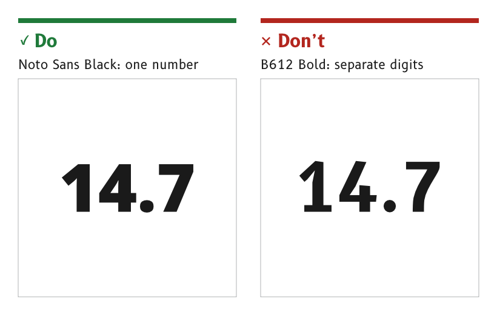

# Typography

Two open-licence typefaces carry every MDD page. Noto Sans Black sets the large data values, and B612 Bold sets the dial numbers, labels and units. Every piece of text takes a named type role, which fixes its size and its typeface.

*Figure 1: Large values use Noto Sans Black.*

## Set large data values in Noto Sans Black

A large data value, such as the wind speed inside the wind dial, is set in Noto Sans at weight 900, Black.

- *Reason.* At large sizes the tight digits of Noto Sans Black read as one number. B612 is spaced wide for cockpit legibility, and in a large number that spacing breaks it into separate digits. Noto Sans Black is also the closest open-licence match to Segoe UI Black, which proved legible at sea on the MDD400.
- *Source.* `ux/specs/pages/common.md`, type roles. Font selection, SCY-SW-NOTE-FONTS-001.

## Set dial numbers, labels and units in B612 Bold

Dial numbers, cell and page labels, units and the touch controls that use them are set in B612 Bold.

- *Reason.* B612 was designed for aircraft cockpit screens and sets every character distinctly, which suits short labels and numbers read at an angle around a dial.
- *Source.* `ux/specs/pages/common.md`, type roles. `ux/specs/pages/wind.md`, dial numbers. Font selection, SCY-SW-NOTE-FONTS-001, citing the [B612 project](https://github.com/polarsys/b612).

## Use a type role, never a free size

Every piece of text takes one of the roles below. The sizes are font sizes in pixels on the 720 × 720 design canvas.

| Role | Size | Typeface | Use |
|---|---|---|---|
| `value-xl` | 240 px | B612 SCADYS Heavy 20, for now | The single main value of a page, such as the compass heading |
| `value-l` | 177 px | Noto Sans Black | The main value inside a dial, such as the wind speed |
| `value-m` | 120 px | B612 SCADYS Heavy 20, for now | Values in the smaller data cells |
| `label` | 44 px | B612 Bold | Cell and page labels, such as HDG, COG and AWS |
| `unit` | 44 px | B612 Bold | Units, such as °M, °T, kt and nm |
| `dial` | 72 px | B612 Bold | Numbers on dial cards |
| `letter` | 72 to 96 px | B612 Bold | Letters on needles and pointers, such as A and T |

- *Page departures.* A page spec may set its own size for a role, and says so. The wind page sets its dial numbers at 42 px, and cuts the A out of its needle in Noto Sans Black at 52 px, because the B612 A has an awkward skewed top.
- *Reason.* A fixed set of roles keeps the same kind of text the same size on every page, so the eye learns where to look.
- *Source.* `ux/specs/pages/common.md`, type roles. `ux/specs/pages/wind.md`.

## Use digits of equal width

Every typeface used for values has digits of equal width by default, without an OpenType feature.

- *Reason.* The LVGL font converter does not apply OpenType features, so a typeface that needs the tabular-figures feature for equal digits would have to be remapped before conversion. Noto Sans and B612 both have equal digits by default. Equal digits are what let a value change without moving, as described under [Motion](./motion.md#keep-the-decimal-point-still).
- *Source.* Font selection, SCY-SW-NOTE-FONTS-001, the candidates.

## Size type in whole pixels

Font sizes are whole pixels, and text baselines sit on whole-pixel rows.

- *Reason.* A fractional size or baseline renders soft on the panel, because each glyph edge is spread over two rows of pixels.
- *Source.* `ux/design/README.md`, "Draw from scratch on whole pixels".

## Use only open-licence typefaces

Every typeface embedded in firmware carries a licence that permits embedding. Noto Sans and B612 are both under the SIL Open Font License 1.1. A modified typeface takes a distinct name and keeps that licence.

- *Example.* B612 SCADYS Heavy is a heavier derivative of B612 Bold, made by thickening the Bold outlines, and is named to keep it apart from the original.
- *Reason.* Segoe UI carried every in-service MDD400 page, but it is licensed for use on Windows, not for embedding in a product.
- *Source.* Font selection, SCY-SW-NOTE-FONTS-001. The fonts and their licences are in `ux/fonts/`.

:::note[Not yet ruled]

- The typeface of `value-xl` and `value-m`. They stay in B612 SCADYS Heavy 20 until they are judged against Noto Sans Black on the panel.
- The final choice of every role, on the MDD500 panel at 1 to 2 m, in direct sun and at night, tracked as SCY-SW-ISSUE-UXPANELTEST-001.

:::

## References

1. Google, [*Noto Sans*](https://fonts.google.com/noto/specimen/Noto+Sans), Google Fonts.
2. PolarSys, [*B612 font family*](https://github.com/polarsys/b612), GitHub.
3. SIL International, [*SIL Open Font License 1.1*](https://openfontlicense.org/open-font-license-official-text/), 2007.
