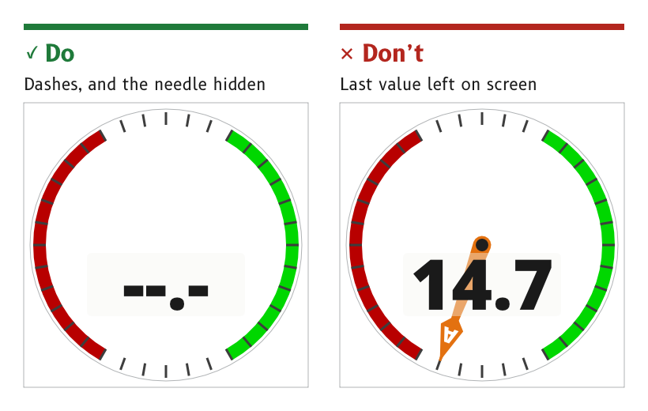

# Data states

Every value on an MDD page is in one of four states: valid, no data, stale or in alert. Each page shows the states the same way, so a reader who has learned one page can trust every other page.

*Figure 1: A value with no data shows dashes, and its needle is hidden.*

## Show a valid value in the data colour

A valid value is drawn in the `data` role, the brightest element on the page that is not an alert.

- *Source.* `ux/specs/pages/common.md`, data states. [Legibility](../foundations/legibility.md#make-the-data-the-brightest-element).

## Replace a missing value with dashes

When a value has no data, its digits are replaced by dashes in the `data` role, and any needle or pointer that depends on it is hidden.

- *Reason.* A frozen number or a needle left at its last angle looks exactly like a live reading. Dashes and a missing needle cannot be mistaken for data.
- *Example.* The wind page in its no-data state shows dashes in place of the speed and hides both wind needles and the wind bug.
- *Source.* `ux/specs/pages/common.md`, data states. `ux/design/wind/BRIEF.md`, page artboards and data each element shows.

## Raise a cue when a data source changes

When the source behind a value changes, for example from one wind instrument to another, the display raises a visual cue.

- *Reason.* Two sources of the same quantity can disagree. A silent change of source looks like a sudden change in the data itself.
- *Source.* MDD400 firmware architecture, SCY-SW-STRATEGY-MDD400ARCH-001, UX and HMI vision.

## Show an alert beside the value it concerns

A value in alert carries the alert triangle, in the `alert` role inside an `alert_outline` outline. The triangle sits clear of the digits, and the value itself keeps its data colour. The alert's behaviour is described under [Alerts](./alerts.md).

- *Reason.* The digits must stay readable while the alert is showing, because the reader needs the value to judge the alert.
- *Source.* `ux/specs/pages/common.md`, data states. `ux/specs/pages/navigation.md`, inside a cell.

:::note[Not yet ruled]

- How a stale value is shown, meaning a value that has stopped updating but has not yet been declared missing. The wind page's first build treats a stale value as no data. The time after which a value counts as stale is set in firmware and tuned on the display.
- The form of the cue raised by a change of data source, and how a page shows which sources it is using.
- The position of the alert triangle inside a data cell.

These are tracked in `ux/specs/pages/common.md`, `navigation.md` and the firmware architecture, SCY-SW-STRATEGY-MDD400ARCH-001.

:::
