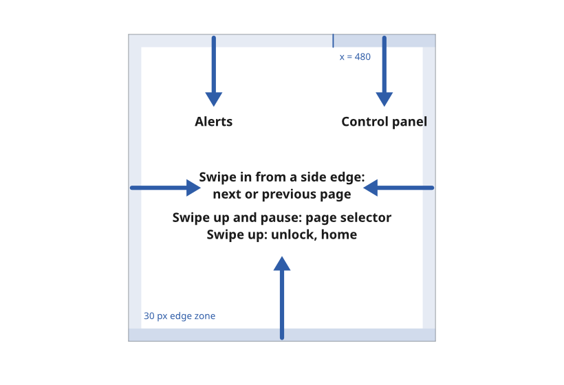

# Gestures

The MDD displays have no physical button, so the glass provides wake, lock, home, back and escape. A small set of system gestures from the screen edges does the work of those buttons, following the iPhone, and a smaller set of page gestures acts on the page itself. Each gesture means the same thing on every page.

*Figure 1: The system gesture zones on the 720 × 720 canvas.*

## Give each gesture one meaning everywhere

A gesture means the same thing on every page. No page gives a system gesture a meaning of its own, and no page blocks one.

- *Reason.* A gesture that changes meaning from page to page cannot become a habit, and a sailor working by feel at night relies on habit.
- *Source.* `ux/specs/interaction/touch.md`, principles. UX concept register, SCY-SW-NOTE-UXCONCEPTS-001, "One meaning per gesture across the product".

## Use the system gestures for what a button would do

A system gesture starts within 30 px of a screen edge and travels at least 120 px inward. It takes priority over any page gesture.

| Gesture | Locked | Unlocked |
|---|---|---|
| Swipe up from the bottom edge | Unlock, returning to the last page | Home, from anywhere |
| Swipe up from the bottom edge and pause before lifting | Unlock only | The page selector, a set of shortcuts to every page |
| Swipe down from the top-right corner | Nothing | The control panel: brightness, night mode, lock and settings |
| Swipe down from the rest of the top edge | Nothing | The alerts list |
| Swipe in from the left or right edge | Nothing | The next or previous page, as a page swipe |

- *The top-right corner* is the right third of the top edge, from x = 480 to the corner, kept inside the MDD500 corner arc.
- *A pause* is the finger held still for 300 ms after the swipe has travelled 120 px.
- *Unlock* needs a longer swipe, at least 240 px, to reject water running down the glass.
- *Reason.* Each gesture copies an iPhone gesture with the same purpose, so it is already learned. The swipe up also matches the MDD400's own unlock.
- *Source.* `ux/specs/interaction/touch.md`, system gestures.

## Treat a swipe from a side edge as a page swipe

A swipe that starts at a side edge changes page, exactly like a swipe that starts mid-page. There is no back gesture from the side.

- *Reason.* A gloved finger cannot reliably aim for an edge or away from one, so the two must mean the same thing. Back is provided by a visible control instead, as described under [Page navigation](./page-navigation.md).
- *Source.* `ux/specs/interaction/touch.md`, system gestures.

## Use the page gestures for the page itself

| Gesture | Meaning |
|---|---|
| Swipe left or right, anywhere on the page | Next or previous page |
| Tap | Act on the control under the finger |
| Long press, 500 ms | Open the options for the item under the finger, such as the data a cell shows |
| Long press, then drag | Move the item, such as a data cell to another position |
| Swipe down on a dialog or panel | Close it |
| Drag on a slider or picker | Change its value |

- *Every drag* has a non-drag alternative, as described under [Touch accessibility](../foundations/touch-accessibility.md#give-every-drag-a-non-drag-alternative).
- *Source.* `ux/specs/interaction/touch.md`, page gestures.

## Tune the thresholds for a moving boat

The gesture thresholds are set wider and longer than phone defaults, because the boat moves and the finger may be gloved.

| Setting | Value | Basis |
|---|---|---|
| Long press | 500 ms | LVGL and Android use 400 ms. Lengthened for motion |
| Long-press repeat | 100 ms | LVGL default, for a stepper held down |
| Tap cancel distance | 16 px | LVGL uses 10 px. Widened for a moving boat |
| Gesture distance | 50 px | LVGL default |
| Edge zone | 30 px | Inside the visible window of both MIPI products |
| Unlock and edge travel | 240 px and 120 px | One third and one sixth of the screen |

- *Source.* `ux/specs/interaction/touch.md`, thresholds.

:::note[Not yet ruled]

- The long-press time, the tap-cancel distance and the 300 ms pause, which are assumptions until tested at sea with wet hands and gloves.
- How a tap on a data cell, which selects the series its graph strip plots, sits beside a tap on the cell's unit, which toggles the unit. The proposal is separate hit zones, the unit area toggling and the value area selecting.

These are tracked in `ux/specs/interaction/touch.md`, open items.

:::
