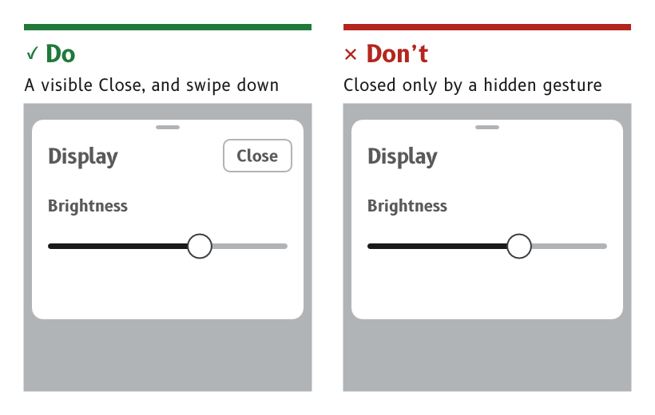

# Page navigation

An MDD display usually shows one page for days, so navigation is occasional. When it happens it must be quick to do by feel, impossible to get lost in and always reversible with one gesture.

*Figure 1: Every dialog and panel has a visible way out.*

## Change page with a horizontal swipe

A swipe left shows the next page and a swipe right the previous one, wherever the swipe starts, including at a side edge.

- *Reason.* Gloves are not precise, so the swipe works wherever it starts rather than asking the finger to find an edge.
- *Source.* `ux/specs/interaction/touch.md`, page gestures. UX concept register, SCY-SW-NOTE-UXCONCEPTS-001, "Left and right swipes change page".

## Jump to any page from the page selector

A swipe up from the bottom edge, held still before lifting, opens the page selector, a set of shortcuts to every page.

- *Reason.* With many pages, swiping through them one at a time to reach a distant page is slow. The selector reaches any page in two moves.
- *Source.* `ux/specs/interaction/touch.md`, system gestures.

## Always provide a way home

A swipe up from the bottom edge returns to the home page from any state, including an open dialog, panel or menu. No page can block it.

- *Reason.* A display with no buttons can trap its user in a state with no exit. One gesture that always works removes that risk.
- *Source.* `ux/specs/interaction/touch.md`, principles and back and escape.

## Give every dialog and panel a visible way out

A dialog, a panel or a sub-page has a visible Close or Back control. It also closes with a swipe down, unless the dialog needs an answer.

- *Reason.* A gesture that has to be remembered is no help to someone who has not learned it. A visible control shows the way out to everyone, and the swipe is the shortcut for those who know it.
- *Source.* `ux/specs/interaction/touch.md`, back and escape. `ux/specs/interaction/controls.md`, presentation.

## Show where the page sits in the set

A set of pages shows page dots, with the current page's dot filled.

- *Reason.* Swipes on the first bench viewer seemed to fail because two pages looked alike. Dots made each swipe visible.
- *Source.* `ux/specs/interaction/controls.md`, presentation. `ux/design/LEARNINGS.md`, entry 26.

:::note[Not yet ruled]

- The order of the pages, which page is home, and how a user adds, removes or reorders pages.
- The layout of the page selector.
- The purpose of the tab at the top centre of the data pages, which may be the handle for a panel that swipes down.
- Where the page dots sit on each layout.

The page selector and the tab are tracked in `ux/specs/interaction/controls.md` and `ux/specs/pages/navigation.md`, open items. The page order, the home page and the page dots are not yet raised in any spec.

:::
