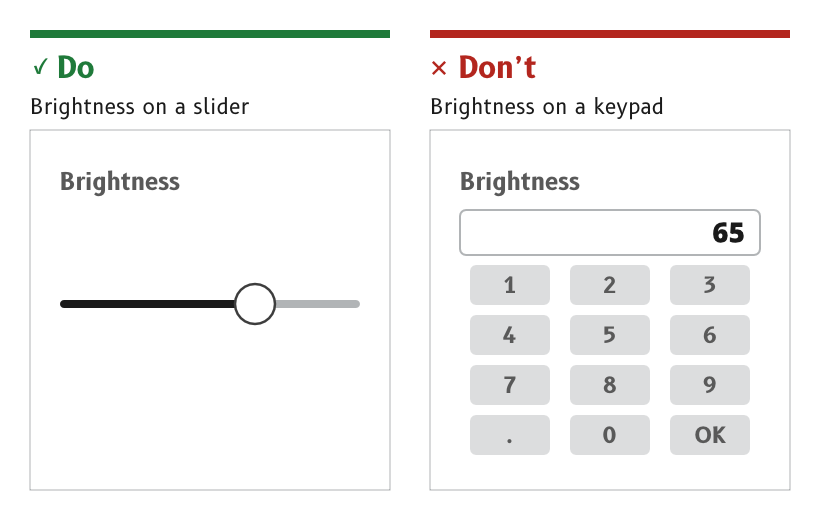
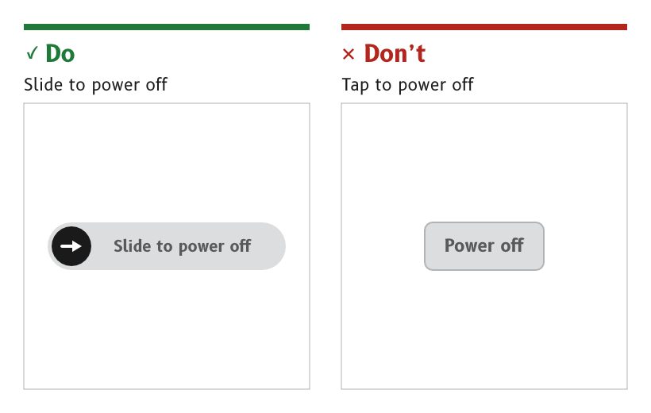

# Settings and confirmation

The MDD displays have no keyboard, and text and number keypads are avoided at all costs. A setting is changed with the largest, simplest control that can do the job, and an action that cannot be undone asks for a deliberate gesture before it happens.

*Figure 1: A value in a range is set with a slider.*

*Figure 2: An action with no undo uses a slide to confirm.*

## Use the first control that can do the job

A setting uses the first control in this order that can do the job.

1. A slider or an arc slider, for any value in a range.
2. A switch or a checkbox, for any on or off choice.
3. A segmented control or a radio group, for one of a few options.
4. A picker or a stepper, for one value from a longer list, or a value that needs finer steps than a slider gives.
5. A numeric keypad, only where none of the above can do it, with its use justified in the page spec.

- *No full keyboard.* There is no free text entry on an MDD display.
- *Reason.* A keypad needs a run of small, accurate taps. A slider, a switch or a picker is worked with one large movement that a gloved hand on a moving boat can make.
- *Source.* `ux/specs/interaction/controls.md`, order of preference and text and numbers.

## Prefer a picker to a dropdown

One value from a list is chosen with a picker, the scrolling LVGL roller, rather than a dropdown menu. A dropdown is used sparingly, and a list page is usually easier to hit.

- *Reason.* A dropdown opens a menu of small targets, and a picker needs no small target at all.
- *Source.* `ux/specs/interaction/controls.md`, choices.

## Confirm an irreversible action with a slide

An action that has consequences and no undo, such as power off, standby or restart, uses a slide to confirm rather than a button.

- *Reason.* A slide replaces the confirmation that a physical button's travel gives. Spray, a brushing hand or a lurch can make a tap, and none of them can make a deliberate slide.
- *Source.* `ux/specs/interaction/controls.md`, actions. `ux/specs/interaction/touch.md`, principles.

## Offer undo for a reversible change

A setting that can be reversed takes effect at once and shows a toast for a few seconds, with an Undo where undo is possible, such as "Units changed to °T".

- *Never for a question.* A toast clears itself, so it never carries anything that needs an answer. A question is a dialog.
- *Reason.* Undo is cheaper for the user than a confirmation on every change, and it keeps the deliberate gestures for the actions that really need them.
- *Source.* `ux/specs/interaction/touch.md`, back and escape. `ux/specs/interaction/controls.md`, presentation.

## Toggle a unit or a source by tapping its label

A label or unit that switches between two states toggles on a tap, such as °M and °T, kt and BFT, or AWS and TWS. Its touch area covers the whole label region.

- *Reason.* The setting sits where its effect is seen, so it needs no menu. The label itself shows the current state.
- *Source.* `ux/specs/interaction/controls.md`, toggle label. UX concept register, SCY-SW-NOTE-UXCONCEPTS-001, "Units are toggles".

:::note[Not yet ruled]

- Whether settings PIN entry needs a keypad, or one picker per digit, which would avoid the keypad altogether.
- The contents and layout of the control panel.
- The data chooser opened by a long press on a cell label.
- The visual design of each control in the palette.

These are tracked in `ux/specs/interaction/controls.md`, open items.

:::
