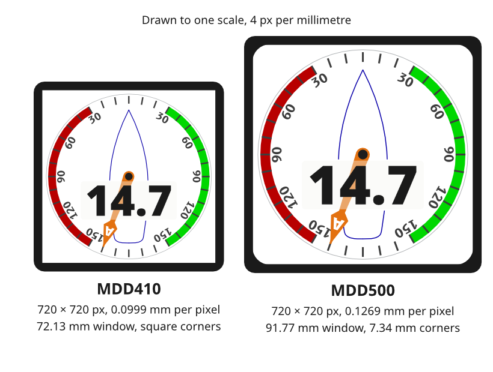

# Platforms

The Foundations, Patterns and Components hold on every SCADYS display. The Platforms pages say what changes from one product to the next: the panel, the window, the touch controller and how far each platform can carry the design.

*Figure 1: One design at two physical sizes.*

## The products

| | MDD400 | MDD410 | MDD500 |
|---|---|---|---|
| Place in the line | Entry level | 4 in, high resolution | 5 in, high resolution |
| Host | ESP32-S3 | ESP32-P4 | ESP32-P4 |
| Display | DWIN T5L smart display, DGUS | 4 in panel, MIPI-DSI | 5.08 in panel, MIPI-DSI |
| Pixels | 480 × 480 | 720 × 720 | 720 × 720 |
| Design scale | Two-thirds | As drawn, the design reference | As drawn, larger |
| Pixel pitch | Not recorded here | 0.0999 mm | 0.1269 mm |
| Visible window | Not recorded here | 72.13 mm square, square corners | 91.77 mm square, 7.34 mm corner radii |
| Brightness | Lower | 1,000 nit | 1,100 cd/m² typical |
| Touch | DWIN touchscreen | Goodix GT911 | Jadard JD9365TX in-cell |
| Rendering | DGUS pages and images | LVGL | LVGL |

- *Source.* MDD400, MDD410 and MDD500 product identity, SCY-PROD-NOTE-MDD400-001, SCY-PROD-NOTE-MDD410-001 and SCY-PROD-NOTE-MDD500-001. `ux/specs/README.md` and `ux/specs/pages/common.md`, canvas and safe area. `ux/specs/interaction/touch.md`, water and spray.

## Pages

| Page | Covers |
|---|---|
| [MDD400](./mdd400.md) | The DWIN DGUS platform and what it cannot show |
| [MDD410](./mdd410.md) | The design reference |
| [MDD500](./mdd500.md) | The larger panel, its rounded window and its in-cell touch |
| [Mobile app](./mobile-app.md) | A placeholder for the planned SCADYS mobile app |
