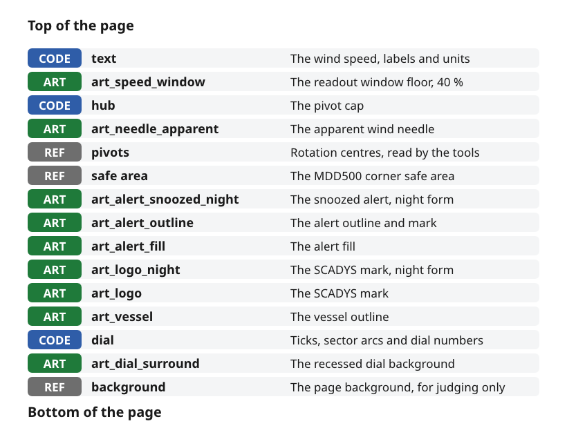

# Layer scheme

A master's layers say what happens to each part of the page. The prefix on a layer's name decides whether its content becomes exported artwork, is drawn by the firmware or is kept for reference only. Nothing is lost from the mockup, because everything stays in one file.

*Figure 1: The layer stack of the wind page master.*

## Name every layer with its prefix

| Prefix | Meaning | Example |
|---|---|---|
| `CODE` | Drawn by the firmware. Kept in the master so the page can be judged, and read for positions, sizes and fonts | `CODE text`, `CODE dial`, `CODE hub` |
| `ART` | Exported as artwork, one layer per asset, named with its asset ID | `ART art_needle_apparent`, `ART art_vessel` |
| `REF` | Reference only, never exported | `REF safe area`, `REF pivots`, `REF background` |

- *Source.* `ux/design/README.md`, layers.

## Stack the layers in the order the page is seen

The layers run in the order the parts sit on the page, from the readout on top down to the background. On the wind page the window and its digits sit above the needle, the needle above the badges and the vessel. The dial and its surround sit below them all.

- *Source.* `ux/design/wind/MDD_Page_Wind.vectorcraft`, read with `vectorcraft-cli`.

## Give each asset one ID and one layer

Every artwork asset has one asset ID, such as `art_needle_apparent`, and its own `ART` layer. An asset used on several pages keeps one page-neutral ID and is drawn once, in the page where it first appears, such as `art_dial_surround`.

- *Two colours.* A two-colour asset is two layers, such as `art_alert_fill` and `art_alert_outline`.
- *Night forms.* A shape that differs at night by more than colour has its own layer, such as `art_logo_night` and `art_alert_snoozed_night`.
- *Source.* `ux/design/README.md`, shared assets and drawing artwork.

## Mark every pivot

Each rotation centre is marked with a small `#FF00FF` cross on `REF pivots`. The layer is left printing, so the tools can read the crosses from the exported file.

- *Source.* `ux/design/README.md`, layers. `ux/design/LEARNINGS.md`, entry 7.

## Show every layer the tools must read

A hidden layer is exported empty, so art on it never reaches the board. Show any layer the push tool must read. Live effects such as drop shadows are also left out of the export, because the tool draws shadows and glows itself.

- *Source.* VectorCraft runbook, the four export facts.

## Push the master to the bench display

`tools/push_to_device.py` exports each master to a layered PDF with `vectorcraft-cli`, renders it and writes the images to the Waveshare Smart 86 Box running the bench viewer, in about a minute.

| View | Layers shown | Use |
|---|---|---|
| `<page>_page` | `ART` and `CODE` | The page as it will look in service |
| `<page>_art` | `ART` only | The artwork that becomes images |
| `<page>_check` | Every printing layer, including `REF pivots` | Checking pivots and alignment |

- *On the board.* A swipe changes view and a tap switches between day and night.
- *16-bit viewer.* The viewer runs the panel at 16-bit colour, so smooth dark gradients show steps there.
- *Source.* `ux/design/README.md`, viewing the page on the device.
