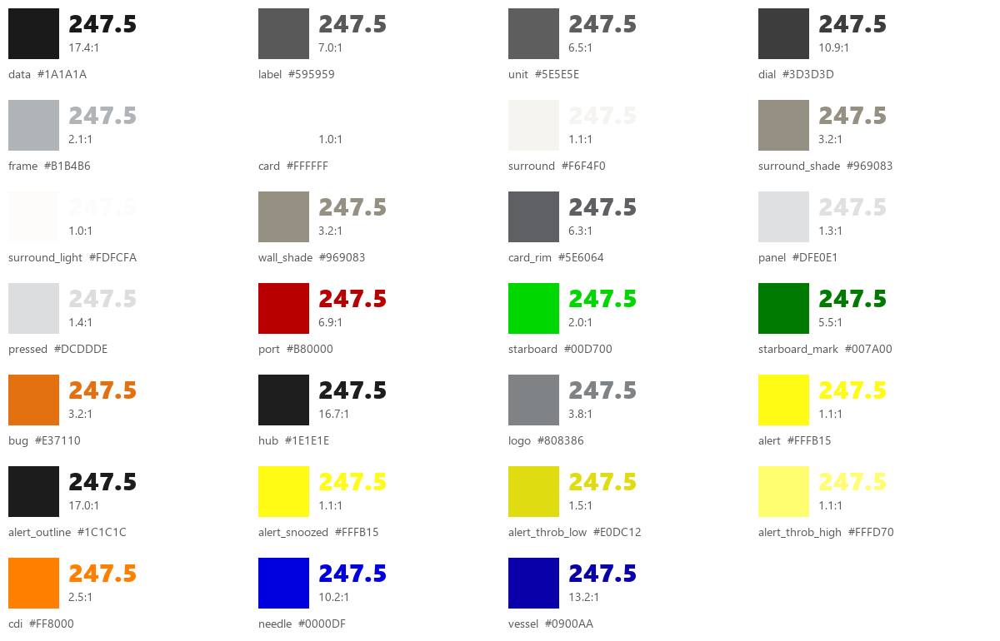
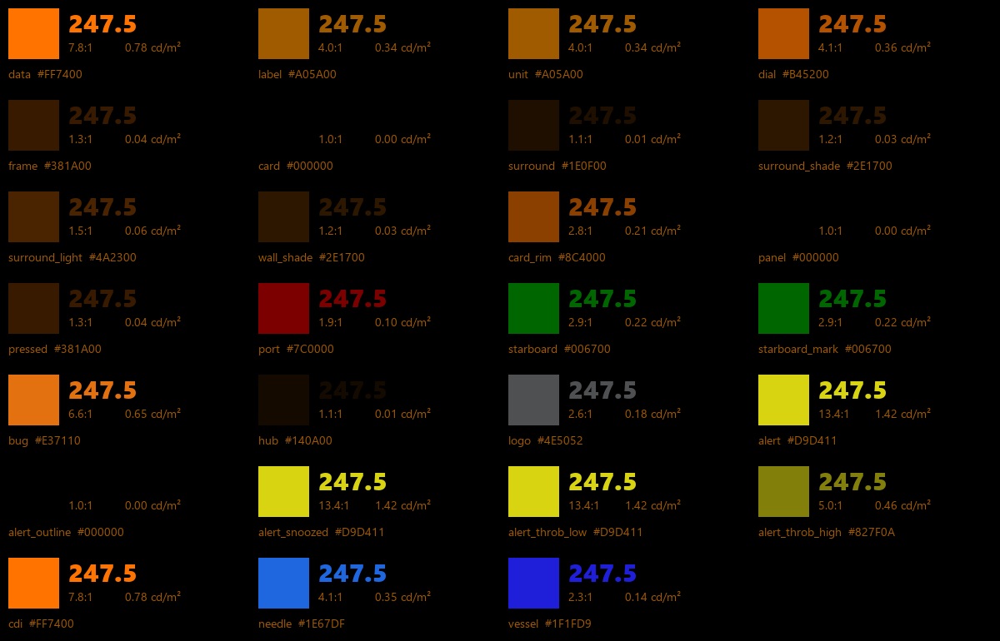

# Palette

`tokens/palette.json` is the single source for every colour on the MDD pages. Every other colour file is generated from it, and nothing is edited by hand downstream of it.

*Figure 1: The day palette preview.*

*Figure 2: The night palette preview, with each role's luminance at the backlight floor.*

## Change a colour in `palette.json` only

Each colour is a named role with a day value, a night value and a note. The file also carries the palette's rules, its open items, the colours it retired and its sources. The full table of roles is on the [Colour](../foundations/colour.md#the-palette) page, generated from the file.

- *Source.* `ux/tokens/README.md`.

## Regenerate everything after a change

After any change to `palette.json`, regenerate its outputs.

| Command | Writes | Use |
|---|---|---|
| `python tokens/render_swatches.py` | `tokens/preview/palette_day.png` and `palette_night.png` | The previews above. It also fails if any night colour other than an alert outshines the data colour |
| `python tokens/make_ase.py` | `tokens/swatches/mdd_day.ase` and `mdd_night.ase` | Swatch libraries in Adobe's format, one global swatch per role |
| `python tokens/make_ai_scripts.py` | `tokens/swatches/mdd_set_day.jsx` and `mdd_set_night.jsx` | Scripts that switch every role swatch in an Illustrator page between day and night |
| `python guidelines/tools/palette_table.py` | The role table on the Colour page | Keeps these guidelines in step with the palette |

- *Planned.* A generator for the LVGL colour header, so the firmware takes its colours from the same file.
- *Source.* `ux/tokens/README.md`.

## Judge night colours on the panel

The night colours are judged on the panel in the dark, never on a desktop monitor, which cannot show them at the panel's brightness. The night preview prints each role's luminance at the backlight floor so that the order of brightness can be checked before the panel test.

- *Source.* `ux/design/LEARNINGS.md`, entry 16. SCY-SW-ISSUE-UXPANELTEST-001.
