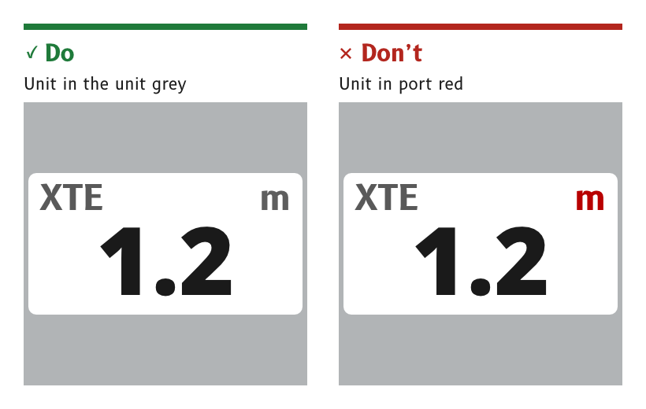

# Colour

Every colour on an MDD page is a named role, such as `data`, `label` or `port`, with one value for day and one for night. Pages, artwork and firmware refer to the role and never to a raw colour, so the whole display changes between day and night by changing the role values alone.

*Figure 1: Red is kept for port, so no text is drawn in it.*

## Colour by role, never by value

An element takes its colour from a palette role. A drawing colours every shape with the role's swatch, and the firmware looks the role up at run time.

- *Reason.* One artwork set serves day and night. A raw colour in a drawing cannot be recoloured for night, and a raw colour in code drifts from the palette the first time the palette changes.
- *Source.* `ux/specs/README.md`, conventions. `ux/specs/pages/common.md`, "One artwork set for day and night".

## Add a role before using a new colour

A design that needs a new colour, such as a lighter or darker shade of an existing role, adds it to the palette as a named role first, with a day and a night value, and then uses it.

- *Reason.* A colour that is not a role has no night value, so it either breaks the night page or gets a night value invented on the spot.
- *Source.* `ux/design/README.md`, "Gradients and highlights".

## Give each role one job and its own day colour

A part that must look different from its neighbours by day or at night gets its own role. No two roles share a day colour if they differ at night.

- *Reason.* The night recolouring finds each colour by its day value. Two roles with the same day colour cannot be told apart, so both take the first role's night colour. The alert outline is held at `#1C1C1C` rather than the data colour `#1A1A1A` for this reason, or it would turn amber at night.
- *Source.* `ux/design/LEARNINGS.md`, entries 17 and 28. Palette rulings, SCY-SW-DECISION-PALETTE-001.

## Keep red for port and green for starboard

Red means port and green means starboard, and neither colour carries any other meaning. No text is drawn in port red. One port red replaces the six reds of the in-service MDD400.

- *Starboard green* is the bright `starboard` role on wide arcs only. Thin lines and ticks use the darker `starboard_mark`, because the bright green has too little contrast on white for a thin mark.
- *At night* both colours stay, dimmed, as decoration. Position already tells the two sides apart.
- *Reason.* A red label reads as a port warning. A red cardinal letter N on a compass card would compete with the port side for the same meaning.
- *Source.* `ux/tokens/palette.json`, rules and the roles `port`, `starboard` and `starboard_mark`. Palette rulings, SCY-SW-DECISION-PALETTE-001.

## Keep yellow for alerts

Yellow is used only for alerts, by day and at night. An active alert is a yellow fill inside a dark outline.

- *Reason.* An alert is rare and has to be seen at once. Yellow used anywhere else would train the eye to ignore it.
- *Source.* `ux/tokens/palette.json`, rules. Palette rulings, SCY-SW-DECISION-PALETTE-001.

## Draw needles and bugs in amber

The apparent wind needle and the target bugs take the amber `bug` role, and each carries a letter so it is not identified by colour alone.

- *Reason.* A red needle and a yellow needle were both tried on the panel and rejected. Red already means port and yellow already means an alert, so either would read as a side or a warning.
- *Source.* `ux/tokens/palette.json`, role `bug`. `ux/design/LEARNINGS.md`, entry 40.

## Keep the SCADYS mark neutral

The SCADYS mark on a dial page takes the `logo` role, a neutral grey by day and a darker grey at night. It is the one neutral grey allowed at night.

- *Reason.* The mark is brand, not data. An amber mark looked wrong, and the dark grey stays far below the brightness of the night data.
- *Source.* Palette rulings, SCY-SW-DECISION-PALETTE-001, consequences.

## The palette

The table below is generated from `ux/tokens/palette.json` by `guidelines/tools/palette_table.py`, so it always matches the palette. The night values are the colours shown at night, and the backlight sets their brightness, as described under [Night](./night.md).

{/* palette-table:start */}

| Role | Day | Night | Use |
|---|---|---|---|
| `background` |  `#FFFFFF` |  `#000000` | White by day per IHO S-52 Ed 6.1.1 s4.2.5. Black at night, never #292728. |
| `data` |  `#1A1A1A` |  `#FF7400` | Primary numerals. Night is the in-service amber #8C4000 at full strength, same hue. |
| `label` |  `#595959` |  `#A05A00` | Cell labels such as HDG and COG. Labels are touch controls. Night is warm amber at about 44 % of data luminance. |
| `unit` |  `#5E5E5E` |  `#A05A00` | Unit text such as kt and °M. Units are touch controls. |
| `dial` |  `#3D3D3D` |  `#B45200` | Dial graduations and dial numbers. Below data luminance at night. |
| `frame` |  `#B1B4B6` |  `#381A00` | Cell borders and dividers. Lines only, never text. |
| `card` |  `#FFFFFF` |  `#000000` | Face of a dial card. Separate from background so a card can be tinted or shaded on its own. |
| `surround` |  `#F6F4F0` |  `#1E0F00` | Panel the dial card is recessed into. Starting value, to be judged by eye. |
| `surround_shade` |  `#969083` |  `#2E1700` | Darker end of the surround gradient and the shadowed upper wall of the recess. |
| `surround_light` |  `#FDFCFA` |  `#4A2300` | Catch-light on the lower wall of the recess. By day a light grey; at night a dim amber, so the wall is lit from above in both modes, per Gerhard 4 October 2026. |
| `wall_shade` |  `#969083` |  `#2E1700` | Shadowed upper wall of the recess. Dark grey by day and black at night, so the wall fades from dark at the top to the catch-light at the bottom. |
| `card_rim` |  `#5E6064` |  `#8C4000` | Inner shadow at the rim of a dial card. A dark shadow by day and an amber glow at night, per Gerhard 4 October 2026. Used at about 40 % opacity and blurred. |
| `panel` |  `#DFE0E1` |  `#000000` | Light panel behind a dial value, such as the wind speed. In-service MDD500 wind master value. None at night. |
| `pressed` |  `#DCDDDE` |  `#381A00` | Fill behind a control while it is touched. |
| `port` |  `#B80000` |  `#7C0000` | One port red replacing six in-service reds. Dim at night, decorative. |
| `starboard` |  `#00D700` |  `#006700` | Wide arcs only by day. Dim at night, decorative. |
| `starboard_mark` |  `#007A00` |  `#006700` | Thin green lines and ticks by day. |
| `bug` |  `#E37110` |  `#E37110` | Apparent wind needle and bugs. Letter-coded, outlined in #1A1A1A by day. Below data luminance at night. |
| `hub` |  `#1E1E1E` |  `#140A00` | The pivot cap over a dial needle, almost black in both modes and shaded as a dome, per Gerhard 10 October 2026. Night is a very dark warm brown, because the night palette allows no neutral grey. |
| `logo` |  `#808386` |  `#4E5052` | The SCADYS mark on the dial pages. A neutral grey in both modes, darker at night, an exception Gerhard made on 10 October 2026 to the rule of no neutral grey at night, because the mark is brand rather than data and amber looked wrong. |
| `alert` |  `#FFFB15` |  `#D9D411` | Alert triangle, a fill inside a 2 px `alert_outline` outline, by day and at night. A snoozed alert takes `alert_snoozed`. |
| `alert_outline` |  `#1C1C1C` |  `#000000` | Outline and symbol on the alert fill. Gerhard ruled #1A1A1A by day on 11 October 2026; it is held two steps off, at #1C1C1C, beyond the swap's matching tolerance of about one step, because the night swap maps colours, not roles, and #1A1A1A is the data day colour, which would turn the outline amber at night. |
| `alert_snoozed` |  `#FFFB15` |  `#D9D411` | A snoozed alert. By day the active alert held still at the alert yellow, filled, outlined and on its drop shadow. At night an outline with a solid exclamation mark in the night alert yellow. Per Gerhard 10 and 11 October 2026. |
| `alert_throb_low` |  `#E0DC12` |  `#D9D411` | One end of an active alert's throb. By day a slightly darker yellow than the alert yellow; at night the night alert yellow. Per Gerhard 11 October 2026. |
| `alert_throb_high` |  `#FFFD70` |  `#827F0A` | The other end of an active alert's throb. By day a slightly brighter yellow, so the throb is centred on the alert yellow that a snoozed alert shows still; at night the night yellow 40% darker. Per Gerhard 11 October 2026. |
| `cdi` |  `#FF8000` |  `#FF7400` | Cross-track indicator. Open: night value, see open items. |
| `needle` |  `#0000DF` |  `#1E67DF` | Open: blue at night, see open items. |
| `vessel` |  `#0900AA` |  `#1F1FD9` | Boat outline. #0000B6 is folded into this. Open: blue at night. |

{/* palette-table:end */}

:::note[Not yet ruled]

- The night blue of the `needle` and `vessel` roles. A blue stimulates the rods that night vision depends on, and an amber or dim red outline is the alternative.
- The night colour of the cross-track indicator, `cdi`, which uses the data amber in the draft.
- The colour of the true wind pointer, because the night palette allows no neutral grey.
- The colour of the compass cardinal letters, now that red means port.
- Every night value, until it is judged on the 4 in and MDD500 panels in the dark.

These are tracked in `ux/tokens/palette.json`, open items and in the page specs.

:::
