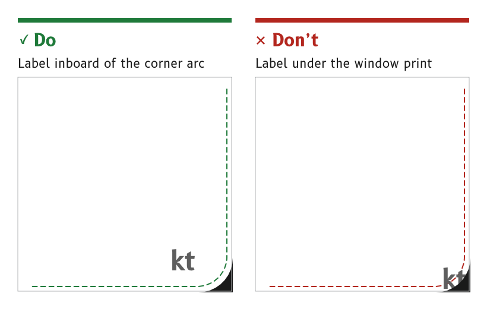

# Layout

Every MDD page is designed once, on a square canvas of 720 × 720 pixels, and each product shows that design on its own panel. Most data pages are built from two standard layouts, while the dial pages have their own.

*Figure 1: Text and touch targets stay inside the MDD500 corner arcs.*

## Design on the 720 × 720 canvas

A page is designed at 720 × 720 pixels, with the origin at the top left and the centre at (360, 360).

- *The 4 in panel.* It shows the canvas pixel for pixel, at 0.0999 mm per pixel. It is the design reference, because a layout that works at 4 in works at least as well at 5 in.
- *MDD500.* The 5 in panel shows the same pixels larger, at 0.1269 mm per pixel, behind a window with rounded corners.
- *MDD400.* The 480 × 480 panel takes every size and position at two-thirds scale.
- *Source.* `ux/specs/README.md`, conventions. `ux/specs/pages/common.md`, canvas and safe area.

## Place everything on whole pixels

Every position, width, height and stroke is a whole pixel, and an edge that must be crisp sits on a pixel boundary. A dial centre is exactly (360, 360), and a rotation pivot sits on a whole or a half pixel.

- *Reason.* A fractional edge is spread across two pixels and renders soft. Masters scaled from the 480 px MDD400 had fractional positions everywhere, so every page is drawn afresh at 720 px.
- *Source.* `ux/design/README.md`, "Draw from scratch on whole pixels".

## Keep text and touch targets inside the corner safe area

Text and touch targets stay inside the MDD500 corner arcs, with a margin of at least 8 px. One layout serves both MIPI products, so every layout follows the MDD500 corners.

- *The arcs.* The MDD500 window is the black print on its cover glass, 91.77 mm square with 7.34 mm corner radii. On the canvas each visible corner is an arc of 58 px radius centred 56 px in from both edges, and about 22 px of panel is hidden along each corner diagonal.
- *The 4 in display.* Its window is square and shows the whole canvas, so its corners may carry background artwork that has no meaning.
- *Reason.* A label or a control in a corner is cut off on the MDD500. The wind page had to move its corner touch labels inboard for this reason.
- *Template.* `ux/design/_template/safe_area_720.svg` draws the safe area for placing on a reference layer.
- *Source.* `ux/specs/pages/common.md`, safe area.

## Build data pages from the standard layouts

A data page uses one of the standard layouts and fills its slots with data, so pages share geometry, behaviour and code. The compass and wind pages are dial pages with their own specs.

| Layout | Slots | First uses |
|---|---|---|
| Primary, four secondary, graphic | One primary value across the top at (6, 6) to (714, 249), four secondary values in a two-by-two grid, and a graphic strip at (6, 600) to (714, 714) | Navigation, engine, battery and charging |
| Data 60, trend 40 | Data in the top 60 % at (6, 6) to (714, 432), and a time-series graph in the bottom 40 % at (6, 438) to (714, 714) | Depth |

- *Cells.* Cells are rounded panels in `background` on a page of `frame`, with 6 px gaps.
- *Inside a cell.* The label sits at the top left and the unit at the top right, each about 15 px in from the cell edge. The value is centred in the cell below them.
- *Graphic strip.* The strip shows a cross-track indicator, a time-series graph of the selected cell or a line of text too long for a cell.
- *Source.* `ux/specs/layouts/README.md`, `primary-4-graphic.md` and `data-60-trend-40.md`. `ux/specs/pages/navigation.md`, inside a cell.

## Size each control for its page

There is no fixed size for a button or an icon. Each is sized for its page under the general rules for touch targets in [Touch accessibility](./touch-accessibility.md#make-touch-targets-large).

- *Reason.* A fixed button size would break the proportions of pages with very different content, such as a dial and a grid of cells.
- *Source.* UX concept register, SCY-SW-NOTE-UXCONCEPTS-001, "No fixed button size".

:::note[Not yet ruled]

- The 8 px corner margin, until it is checked on an assembled MDD500.
- The purpose of the tab at the top centre of the data pages, at (234, 0) to (486, 32).
- How other data pages vary the grid, such as fewer, larger cells.
- What the data area of the data 60, trend 40 layout holds.

These are tracked in `ux/specs/pages/common.md` and in the layout and page specs.

:::
