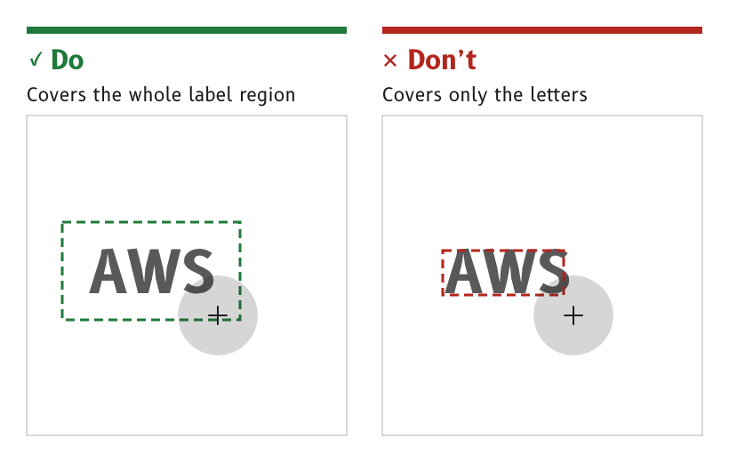

# Touch accessibility

The MDD displays have no physical button, and they are used on a moving boat by people wearing sailing gloves, with spray on the glass. Every touch on the display is designed for the least precise finger in the worst conditions, and the full gesture vocabulary builds on these rules in the Patterns section.

*Figure 1: A label's touch area covers its whole region.*

## Do everything with one finger

No function needs two fingers. Every path or drag gesture has a single-finger alternative that needs no path.

- *Reason.* Two-finger gestures fail on wet glass and with gloves, and [WCAG 2.2](https://www.w3.org/TR/WCAG22/) success criterion 2.5.1 requires a single-pointer alternative anyway.
- *Source.* `ux/specs/interaction/touch.md`, principles.

## Act on release

A tap acts when the finger lifts. Sliding off the control before lifting cancels the tap.

- *Reason.* A touch made by a lurch of the boat can be abandoned by sliding away, which WCAG 2.2 success criterion 2.5.2 requires.
- *Source.* `ux/specs/interaction/touch.md`, principles.

## Make touch targets large

A touch target is about 9 mm across, and targets are at least 8 mm apart from centre to centre. Controls used while under way are larger than that, not smaller.

- *On the canvas.* 9 mm is 90 px and 8 mm is 80 px on the 4 in panel. The MDD500 shows the same pixels about 27 % larger, so a target sized for the 4 in panel is larger still on the MDD500.
- *Reason.* [Parhi and others](https://doi.org/10.1145/1152215.1152260) found that tap errors stop improving at about 9.6 mm, and [Google recommends](https://support.google.com/accessibility/android/answer/7101858) 7 to 10 mm. Errors rise with motion and vibration, which a boat has in abundance.
- *Source.* `ux/specs/interaction/touch.md`, touch targets.

## Cover the whole label region

The touch area of a label or a unit covers its whole label region, not only the letters.

- *Reason.* A gloved finger lands near a label rather than on its letters. A target the shape of its glyphs is far smaller than it looks.
- *Source.* `ux/specs/interaction/touch.md`, touch targets. `ux/specs/interaction/controls.md`, toggle label.

## Make consequential actions deliberate

An action with consequences needs a deliberate gesture, such as a long swipe or a slide to confirm. An action with no undo, such as power off or restart, uses a slide to confirm.

- *Reason.* Spray and a brushing hand produce short accidental touches. A deliberate gesture is one they cannot make.
- *Source.* `ux/specs/interaction/touch.md`, principles. `ux/specs/interaction/controls.md`, actions.

## Give every drag a non-drag alternative

Anything that can be dragged can also be changed without dragging. A slider takes a tap on its track or a stepper, and a cell can be moved through its options as well as by dragging.

- *Reason.* A drag is hard to hold steady on a moving boat, and WCAG 2.2 success criterion 2.5.7 requires an alternative.
- *Source.* `ux/specs/interaction/touch.md`, page gestures. `ux/specs/interaction/controls.md`, values.

## Give feedback that can be seen

Every touch gives visual feedback, as a pressed fill behind the control. The buzzer may click on a tap as well, as an option the user can turn off.

- *Reason.* The buzzer is the display's haptic. Apple's guidelines treat haptics as an addition to visual feedback, never a replacement. The MDD displays follow them.
- *Source.* `ux/specs/interaction/touch.md`, feedback.

## Reject water and palms

While a single-finger gesture is in progress, the firmware ignores frames with more than one contact. It also ignores large contacts, such as a palm or a sheet of water. In heavy spray the lock is the user's defence.

- *Reason.* Water on the glass is the main source of error for self-capacitance sensing, and the GT911 controller on the 4 in panel has no water setting, so wet handling comes from tuning and firmware filtering.
- *Source.* `ux/specs/interaction/touch.md`, water and spray. `ux/specs/interaction/research/harsh-environment-and-buttonless.md`.

## Avoid keypads

Text and number keypads are avoided. A setting uses a slider, a switch, a segmented control, a picker or a stepper wherever one can do the job, and a numeric keypad only where none can. There is no full keyboard.

- *Reason.* A keypad needs a run of small, accurate taps, while a switch or a segmented control needs one large tap.
- *Source.* `ux/specs/interaction/controls.md`, order of preference.

:::note[Not yet ruled]

- The long-press time and the distance a finger may move before a tap is cancelled, to be tested at sea with wet hands. The drafts are 500 ms and 16 px.
- Target sizes for gloved hands. No published study gives them, so they are to be tested with sailing gloves at sea.
- How the in-cell touch of the MDD500 behaves with water, to be checked on the bench.
- Whether settings PIN entry needs a keypad, or one picker per digit.

These are tracked in `ux/specs/interaction/touch.md` and `controls.md`, open items.

:::

## References

1. World Wide Web Consortium, [*Web Content Accessibility Guidelines (WCAG) 2.2*](https://www.w3.org/TR/WCAG22/), W3C, 2024.
2. P. Parhi, A. K. Karlson and B. B. Bederson, [*Target size study for one-handed thumb use on small touchscreen devices*](https://doi.org/10.1145/1152215.1152260), Proceedings of MobileHCI 2006, ACM, 2006.
3. Google, [*Touch target size*](https://support.google.com/accessibility/android/answer/7101858), Android Accessibility Help.
