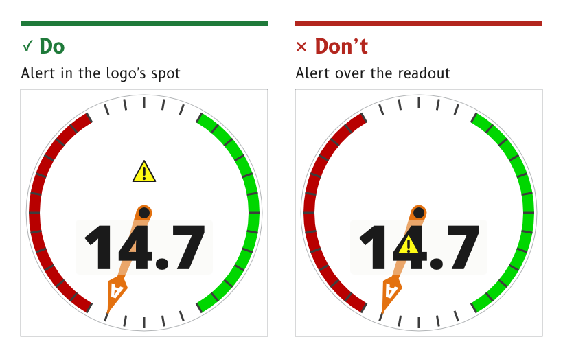

# Alerts

An alert is the one element on an MDD page allowed to break the quiet. It is yellow, it moves and it may outshine the data, because it is rare and has to be seen. Once it has been seen it can be snoozed, so it stops asking for attention but stays in view until it is cleared.

*Figure 1: On a dial page the alert takes the logo's spot.*

## Draw an alert as a yellow triangle

An alert is a triangle with an exclamation mark. Its fill is the `alert` role and its outline and mark are the `alert_outline` role.

- *By day* the fill is `#FFFB15` inside a near-black outline, and the triangle floats on a drop shadow.
- *At night* the fill is `#D9D411` inside a black outline.
- *Reason.* The triangle is recognised by its shape as well as by its colour, so it reads as an alert even where yellow is washed out.
- *Source.* `ux/specs/pages/wind.md`, alert. `ux/tokens/palette.json`, roles `alert` and `alert_outline`.

## Put the alert in the logo's place on a dial page

On a dial page the alert and the SCADYS mark share one spot, above the pivot. An active alert replaces the mark, and the alert sits behind the needle.

- *Reason.* The spot sits clear of the readout and the dial numbers, so an alert never covers the value it is about.
- *Source.* `ux/specs/pages/wind.md`, alert. UX concept register, SCY-SW-NOTE-UXCONCEPTS-001, "The alert takes the logo's place".

## Throb an active alert

An active alert throbs about once a second at full opacity, as described under [Motion](../foundations/motion.md#throb-an-active-alert-and-hold-a-snoozed-one-still).

- *Source.* `ux/specs/pages/wind.md`, alert.

## Snooze an alert with a long press, and keep it in view

A long press on an active alert snoozes it. A snoozed alert stops throbbing but stays on the page, in the `alert_snoozed` role.

- *By day* a snoozed alert is the active alert held still at `#FFFB15`, filled, outlined and on its drop shadow.
- *At night* a snoozed alert is a yellow outline with a solid exclamation mark.
- *Reason.* A snoozed alert has been seen, so it stops asking for attention. It stays visible because the condition behind it has not gone away. An outline-only form by day was too hard to see on the white card.
- *Source.* `ux/specs/pages/wind.md`, alert. Palette rulings, SCY-SW-DECISION-PALETTE-001, consequences.

## Raise an alert with its dialog, and let the dialog close itself

A raised alert sounds, throbs in the logo's spot and opens its dialog. A dialog left alone closes itself after a short time-out, 10 s by default and configurable. The alert is then auto-snoozed: it falls silent, but its icon keeps throbbing, because nobody has dealt with it yet. A tap on the throbbing icon opens the dialog again. Any touch on an open dialog restarts its time-out. When the auto-snooze ends with the condition still there, the dialog opens again with its sound.

- *Reason.* The skipper may be hand-steering through closed waters with both hands busy and eyes on the water, where 20 s can be a lifetime. A dialog that covers the data until it is cleared by hand takes a hand off the wheel at the worst moment. The Simrad NSS Evo3 shows the failure: its alarms cover the chart centre, need a hand to clear, and come straight back a few seconds later.
- *Source.* Gerhard, 27 October 2026. UX concept register, SCY-SW-NOTE-UXCONCEPTS-001, "A dialog closes itself".

## Snooze or dismiss in the dialog

An alert's dialog carries SNOOZE and DISMISS, and a dialog that asks for something carries its controls and SAVE as well. SNOOZE holds the icon still and silent until the snooze ends. DISMISS takes the alert away: with its condition gone it is cleared, and with the condition still there it stays away until the condition clears and returns, or gets worse. A long press on the icon also snoozes it.

- *Reason.* A snoozed alert has been seen, so it stops asking for attention but stays in view. A dismissed alert has been dealt with, so it goes, but a new occurrence or a worse one is a new event and is raised again.
- *Snooze length.* A snoozed alert does not come back within seconds. It comes back when its snooze ends, or at once if the condition gets worse.
- *Source.* Gerhard, 27 October 2026. `ux/specs/interaction/touch.md`, principles.

## Cancel an alert once its condition has stayed clear, unless it must be logged

Every alert carries a configurable auto-cancel: a level and a time. When the condition has stayed back on the safe side of the cancel level for the cancel time, the alert is cancelled completely, from the page and from the list of active alerts. A depth alert at 2.0 m, for example, might cancel once the depth has stayed deeper than 2.5 m for 15 minutes.

- *Logged alerts never cancel themselves.* An alert that records a fault with the instrument or its supply, such as over-temperature or over- and under-voltage, is written to a log with its time, its peak reading and its duration, and it stays in view until it is dismissed by hand.
- *Reason.* Most alerts describe the boat's situation, and once that has stayed clear for long enough an alert left in view is clutter, so it goes by itself. A fault in the instrument or its power is evidence for later, of what the box went through, so it is kept until someone has seen it.
- *Source.* Gerhard, 27 October 2026.
## Put the alert's limit in the dialog's header

The header of an alert's dialog shows the limit that raised it, such as a depth of 2.0 m or a temperature of 65 °C, between a minus and a plus key, so the limit can be moved on the spot without opening the settings.

- *Reason.* A limit often needs to move while the alert is up, such as the depth limit as the boat comes in toward land.
- *Source.* Gerhard's MDD400 depth-alarm dialog master, and Gerhard, 27 October 2026.

## Draw a dialog on frosted glass

A dialog sits on the whole page turned to frosted glass, blurred and darkened, and fades in and out. The card has rounded corners, a header bar carrying the title or the limit, a body, and a bar of buttons along the bottom.

- *Reason.* The page stays recognisable behind the dialog, so the skipper keeps their bearings, while the card stands clear of it.
- *Source.* Gerhard's MDD400 dialog masters, where the frosted glass could not be made to work on the DGUS display, and Gerhard, 27 October 2026.
## Let the skipper set how loud the sounds are

The volume of alert and prompt sounds is a user setting. Its loudest step is the hardware's full scale, and the sounds are pitched at 2 to 3 kHz, where hearing is keenest and clear of engine and wind noise.

- *Reason.* What is right on a quiet mooring at night is inaudible under way with the engine running. On the first prototype even full scale, about 70 dB at half a metre in free air, was judged too soft for a boat.
- *Source.* Gerhard, 27 October 2026.
## Share alerts across the displays on a boat

A boat may carry several displays, and its alerts are set once for the boat rather than once per display.

- *Shared settings.* An alert's settings, its limit, its cancel level and time and its volume, are shared between the displays, so a change made on one reaches the others.
- *Alerts off for a display.* Alerts can be turned off completely on any one display, such as one at the chart table that should stay quiet while the helm display carries them.
- *All alerts on one display.* One display can carry every alert on the boat, including those whose data it does not show on its own pages.
- *Reason.* A skipper sets a depth limit once for the boat, not on every screen, and decides where on board each alert should sound and show.
- *Source.* Gerhard, 27 October 2026.
## List alerts from the top edge

A swipe down from the top edge, away from its right-hand third, opens the list of active and recent alerts.

- *Reason.* It is where a phone keeps its notifications, so the gesture is already learned.
- *Source.* `ux/specs/interaction/touch.md`, system gestures.

:::note[Not yet ruled]

- The raise, auto-snooze, snooze and dismiss rules are built in the heat-soak bench app, `mdd_ux_viewer`, with the rules in `main/alert.c` under host tests, and not yet in product firmware.
- The layout and contents of the alerts list.
- Whether alerts carry severities, such as information, alert and critical, as the MDD400 firmware architecture proposed, and how each would look. The bench app trials two, warning and critical, with a three-beep sound for a warning and a two-tone for critical.
- How long a snooze lasts. The bench app trials 10 minutes for SNOOZE and for an alert's auto-snooze, and 2 minutes for a prompt's auto-snooze.
- The throb's size element. The bench app trials a swell of 8 % at the peak of each throb.
- How alert settings are shared between displays. NMEA 2000 is the likely route, with Wi-Fi to a Signal K server considered as a fallback.
- The default cancel level and time for each alert, and which further alerts are logged.
- The volume setting's steps, where it sits in the settings, and whether a critical alarm may be turned down below a floor or turned off.
- The dialog palette, day and night. The bench app trials a night card of greys with light titles, values in the data orange, and muted green, blue and grey buttons. The frost there is the page blurred twice and darkened to 40 %, fading over 250 ms.

These are tracked in `ux/specs/pages/wind.md`, `ux/specs/interaction/controls.md` and the firmware architecture, SCY-SW-STRATEGY-MDD400ARCH-001.

:::
