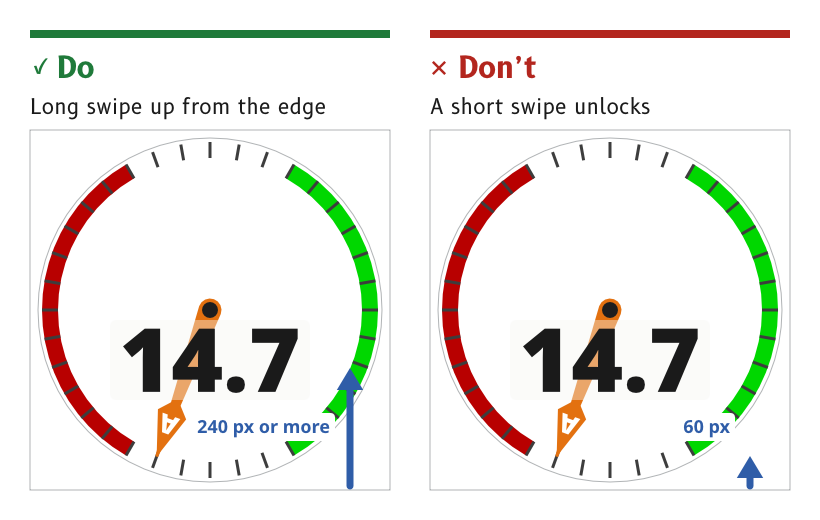

# Lock and wake

An MDD display runs whenever it has power and spends most of its life locked. Locked, it shows its data and ignores every touch except the unlock swipe, so spray, a sleeve or a sheet of water cannot change anything.

*Figure 1: Unlock takes a long swipe up from the bottom edge.*

## Keep the display on whenever it has power

The display runs whenever it has power. It can be switched off by touch only from the control panel, with a slide to confirm.

- *Reason.* An instrument that has to be woken before it can be read has failed at its job. The Raymarine Alpha and the B&G Nemesis also run whenever they have power.
- *Source.* `ux/specs/interaction/touch.md`, lock and wake.

## Lock on a timer, and let the user change it

Auto-lock is on by default and locks the display after 30 s without a touch. The timeout can be changed in settings, and auto-lock can be turned off, for example on a display mounted below deck.

- *Reason.* In normal use nobody touches the display for long spells, so locking costs little and protects against accidental touches. An indoor display that is never splashed does not need it.
- *Source.* `ux/specs/interaction/touch.md`, lock and wake. UX concept register, SCY-SW-NOTE-UXCONCEPTS-001, "Auto-lock on by default".

## Lock by hand from the control panel

The control panel has a Lock control, so a user can lock the display at once, for example before heavy weather.

- *Reason.* The lock is the user's defence in heavy spray. The Raymarine Alpha manual gives severe weather as the reason for its own lock.
- *Source.* `ux/specs/interaction/touch.md`, lock and wake and water and spray.

## Show data while locked, and ignore every other touch

A locked display shows its page as normal and ignores every touch except the unlock swipe.

- *Reason.* Locking protects the settings, not the view. The data stays readable at a glance whether the display is locked or not.
- *Source.* `ux/specs/interaction/touch.md`, lock and wake.

## Unlock with a long swipe up from the bottom edge

A swipe up from the bottom edge of at least 240 px, one third of the screen, unlocks the display and returns to the last page shown.

- *Reason.* Water running down the glass can produce a short upward swipe, and it cannot produce one 240 px long. The same swipe up is home once unlocked, so one movement always means "get me back".
- *Source.* `ux/specs/interaction/touch.md`, system gestures. The MDD400 firmware, which already unlocks with a swipe up.

## Wake without acting

If a standby mode dims the display, a tap wakes it without acting on whatever is under the finger.

- *Reason.* The first touch on a dimmed display is a request to see it, not a choice of control.
- *Source.* `ux/specs/interaction/touch.md`, lock and wake.

:::note[Not yet ruled]

- Whether a standby mode exists, and what wakes it.
- Whether auto-lock is suspended while the autopilot is engaged, as on the Raymarine Alpha.
- Whether the page shows that it is locked, and how.

The standby mode is tracked in `ux/specs/interaction/touch.md`, open items. The other two are not yet raised in any spec.

:::
